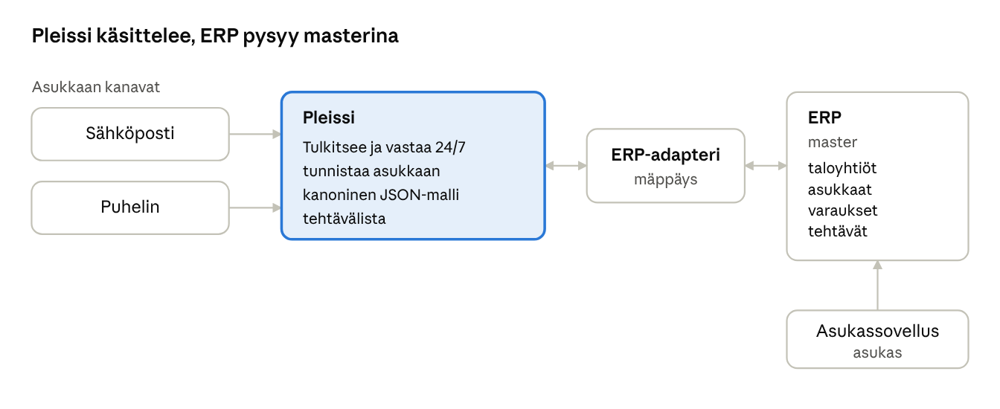

# Pleissi – integraatiospesifikaatio

Oct 24, 2026 · @oskari

> Muunnettu Word-tiedostosta "Pleissi – integraatiospesifikaatio" (24.10.2026). Toteutuksen tarkennukset
> (26.10.2026) on merkitty tekstiin ja koottu loppuun osioon *Toteutus: vaihe 1*.

## Tarkoitus ja laajuus

Pleissi vaihtaa tietoa asiakkaan toiminnanohjausjärjestelmän (jatkossa ERP) kanssa neljässä kokonaisuudessa: taloyhtiöt, asukkaat, varaukset ja tehtävät. Sanomat on määritelty järjestelmäriippumattomasti, jotta sama malli toimii kaikkiin isännöintijärjestelmiin.

| Kokonaisuus | Suunta        | Pleissi                                          | Master                     |
|-------------|---------------|--------------------------------------------------|----------------------------|
| Taloyhtiöt  | ERP → Pleissi | Lukee                                            | ERP                        |
| Asukkaat    | ERP → Pleissi | Lukee, tunnistaa yhteydenottajan                 | ERP                        |
| Varaukset   | Molemmat      | Lukee vapaat vuorot, luo ja peruu varauksia      | ERP                        |
| Tehtävät    | Molemmat      | Luo, käsittelee, päivittää statusta ja kommentoi | ERP (käsittely Pleississä) |

**Ei kuulu laajuuteen:** laskutus, kirjanpito, vastikkeet, omistajuustiedot ja huoltoyhtiön järjestelmät. Asukastietoja ei muokata Pleissistä: muutokset tehdään ERP:hen.

**Huom:** ERP-kohtaiset kenttänimet ja rajapinnan rakenne vaihtelevat. Tämä dokumentti kuvaa Pleissin kanonisen mallin; mäppäys kunkin ERP:n muotoon tarkennetaan, kun sen dokumentaatio saadaan.

## Arkkitehtuuri ja periaatteet

ERP on master kaikelle perusdatalle, ja Pleissi on käsittelykerros, joka ottaa yhteydenotot vastaan, tulkitsee ne ja kirjoittaa lopputuloksen takaisin ERP:hen.



kokonaisarkkitehtuuri · kanavat, Pleissi, adapteri, ERP

Sähköposti ja puhelin tulevat Pleissiin, asukassovelluksen pyynnöt ERP:hen; adapteri pitää molemmat samassa tilassa.

1.  **Yksi kanoninen sanoma.** Pleissi puhuu sisäisesti ja ulospäin vain tämän dokumentin JSON-muotoa. Järjestelmäkohtainen käännös tehdään adapterissa.

2.  **Master päätetään per kokonaisuus.** Kenttää muokataan vain masterissa. Pleissi ei koskaan ylikirjoita ERP:n asukas- tai taloyhtiötietoja. Pleissi ei kirjoita suoraan ERP:n tauluihin, vaan kutsuu ERP:n API:a; ERP tarkistaa ja tallentaa muutoksen itse. Pleissi kirjoittaa vain varauksia, tehtäviä ja kommentteja.

3.  **Tapahtumat, ei jättisanomaa.** Jokainen muutos on oma tapahtumansa (esim. task.updated), ei yksi sanoma kaikesta.

4.  **Kaksi siirtotapaa, sama sanoma.** Pleissi voi hakea muutokset ERP:n rajapinnasta (pull) tai vastaanottaa ne webhookina (push). Kumpi tahansa valitaan, sanoman sisältö on sama.

5.  **Ulkoiset ID:t talteen.** Jokaisella oliolla on Pleissin oma ID ja externalRefs-kenttä, johon tallennetaan ERP:n ID. Kaikki kirjoitukset ERP:hen kohdistetaan ERP:n ID:llä.

| Siirtotapa        | Miten                                                                                                                                         | Pleissiltä vaaditaan                                                              |
|-------------------|-----------------------------------------------------------------------------------------------------------------------------------------------|-----------------------------------------------------------------------------------|
| Pull              | Pleissi kysyy ERP:n API:sta muutoksia: tehtävät ja varaukset 1–2 min välein, asukkaat ja taloyhtiöt kerran vuorokaudessa (GET + updatedSince) | Ajastettu haku, viimeisen haun aikaleima talteen                                  |
| Push (webhook)    | ERP kutsuu Pleissin osoitetta heti muutoksen tapahduttua; varmistuksena harva pull tunnin välein                                              | Yksi vastaanottava endpoint, esim. POST /webhooks/erp, allekirjoituksen tarkistus |
| Kirjoitus ERP:hen | Pleissi kutsuu ERP:n API:a (POST, PATCH, DELETE)                                                                                              | ERP-adapteri, joka kääntää kanonisen sanoman ERP:n muotoon                        |

**Tapahtumaloki.** Pleissi tallentaa jokaisen muutoksen tapahtumana (tämän dokumentin sanomamuodossa) omaan lokiinsa ennen kuin mitään lähetetään. ERP-adapteri lukee tapahtumat lokista ja kutsuu ERP:n API:a. Näin:

- epäonnistunut kutsu voidaan uusia, eikä mikään muutos katoa ERP:n katkon aikana

- jokaisesta tehtävästä näkyy täysi historia

- Pleissin omat webhookit muille järjestelmille (ks. Myöhemmät vaiheet) voidaan myöhemmin rakentaa samojen tapahtumien päälle ilman muutoksia ytimeen

**Pääsy lokiin:** tapahtumaloki on Pleississä oma näkymänsä, joka vaatii kirjautumisen ja erikseen annetun oikeuden (esim. rooli "Integraatioloki: luku"). Oletuksena oikeus on vain Pleissin ylläpidolla ja asiakkaan pääkäyttäjällä. Muut käyttäjät näkevät tehtävän historian tehtävän omalla sivulla ilman raakasanomia. Lokin katselu kirjataan itsekin, koska sanomissa on henkilötietoja.

## Sanomakuori ja yhteiset säännöt

Jokainen sanoma on samassa kuoressa: kuori kertoo mitä tapahtui, milloin ja kenelle, ja data sisältää itse olion.

```json
{
  "eventId": "evt_01HZX8K2M4",
  "eventType": "task.updated",
  "schemaVersion": "1.0",
  "occurredAt": "2026-10-24T18:45:00+03:00",
  "source": "pleissi",
  "tenantId": "asiakas-001",
  "sequence": 42,
  "data": {}
}
```

| Kenttä        | Merkitys                                                                                                       |
|---------------|----------------------------------------------------------------------------------------------------------------|
| eventId       | Uniikki tunniste. Vastaanottaja ohittaa saman ID:n toiseen kertaan (idempotenssi).                             |
| eventType     | \<olio\>.\<tapahtuma\>, esim. booking.created. Lista alla.                                                     |
| schemaVersion | Sanomamallin versio. Kenttiä voi lisätä ilman versionnostoa; poisto tai merkityksen muutos nostaa pääversiota. |
| occurredAt    | Milloin muutos tapahtui, ISO 8601 aikavyöhykkeellä.                                                            |
| source        | Kuka muutoksen teki: pleissi tai erp. Estää synkkasilmukat.                                                    |
| tenantId      | Asiakas (isännöintitoimisto).                                                                                  |
| sequence      | Juokseva numero per olio. Vanhempi sanoma ei koskaan ylikirjoita uudempaa.                                     |

**Tapahtumatyypit**

| Olio      | Tapahtumat                                          |
|-----------|-----------------------------------------------------|
| Taloyhtiö | housingCompany.upserted, housingCompany.deleted     |
| Asukas    | resident.upserted, resident.moved_out               |
| Varaus    | booking.created, booking.cancelled, booking.updated |
| Tehtävä   | task.created, task.updated                          |
| Kommentti | task.comment.added                                  |

**Yhteiset säännöt**

- Kenttänimet englanniksi camelCasena (housingCompany, validUntil).

- Ajat ISO 8601 -muodossa offsetin kanssa (2026-10-24T20:00:00+03:00). Toistuvat ajat paikallisena kellonaikana + timeZone: "Europe/Helsinki", koska kesäaika muuttaa offsetin.

- Puhelinnumerot E.164-muodossa (+358401234567), sähköpostit pienillä kirjaimilla.

- Puuttuva arvo on null, ei tyhjä merkkijono.

- Jokaisessa oliossa id (Pleissin) ja externalRefs ({"erp": "..."}).

## Taloyhtiöt

Taloyhtiöt ja niiden asunnot luetaan ERP:stä. Pleissi tarvitsee ne, jotta yhteydenotto ja varaus voidaan kohdistaa oikeaan yhtiöön ja asuntoon, ja jotta AI tietää yhtiön varattavat tilat.

- **Suunta:** ERP → Pleissi, vain luku

- **Tahti:** kerran vuorokaudessa + heti, jos tuntematon yhtiö tulee vastaan

- **ERP-lähde:** taloyhtiön perustiedot ja huoneistoluettelo (näkymä ja endpoint vahvistetaan ERP-toimittajalta)

- **Käyttö Pleississä:** tehtävän kohdistus, varausten resurssit, AI:n taustatiedot

```json
{
  "eventType": "housingCompany.upserted",
  "source": "erp",
  "data": {
    "id": "hc_koivikko",
    "externalRefs": {
      "erp": "ERP-HC-1182"
    },
    "name": "As Oy Koivikko",
    "businessId": "1234567-8",
    "address": {
      "street": "Koivukuja 4",
      "postalCode": "01600",
      "city": "Vantaa"
    },
    "apartments": [
      {
        "id": "apt_b8",
        "externalRefs": {
          "erp": "ERP-APT-5521"
        },
        "label": "B 8",
        "staircase": "B",
        "number": "8"
      },
      {
        "id": "apt_b9",
        "externalRefs": {
          "erp": "ERP-APT-5522"
        },
        "label": "B 9",
        "staircase": "B",
        "number": "9"
      }
    ],
    "bookableResources": [
      {
        "id": "res_sauna",
        "externalRefs": {
          "erp": "ERP-RES-77"
        },
        "type": "sauna",
        "name": "Taloyhtiön sauna"
      },
      {
        "id": "res_laundry",
        "externalRefs": {
          "erp": "ERP-RES-78"
        },
        "type": "laundry",
        "name": "Pesutupa"
      }
    ],
    "propertyManager": {
      "name": "Isännöitsijän nimi",
      "email": "isannoitsija@isannointi.example"
    }
  }
}
```

| Kenttä            | Pakollinen | Huom                                                      |
|-------------------|------------|-----------------------------------------------------------|
| name              | Kyllä      | Virallinen nimi                                           |
| businessId        | Ei         | Y-tunnus, hyvä täsmäytysavain                             |
| apartments        | Kyllä      | Ilman asuntoja asukasta ei voi kohdistaa                  |
| bookableResources | Ei         | Jos ERP palauttaa ne erikseen, haetaan varausrajapinnasta |
| propertyManager   | Ei         | Kenelle tehtävät ohjataan                                 |

## Asukkaat

Asukastiedoilla Pleissi tunnistaa, kuka ottaa yhteyttä ja mihin asuntoon pyyntö kuuluu. Minimi on nimi, sähköposti, puhelin ja asunto; ERP:n asukas-ID tarvitaan, jotta varaukset ja tehtävät voidaan kirjoittaa oikealle henkilölle.

- **Suunta:** ERP → Pleissi, vain luku. Asukas ilmoittaa uuden numeron → Pleissi tekee tehtävän isännöitsijälle, ei muuta tietoa itse.

- **Tahti:** kerran vuorokaudessa (tai webhook) + heti, jos tuntematon yhteystieto tulee vastaan

- **ERP-lähde:** asukasrekisteri / huoneiston asukkaat (vahvistetaan ERP-toimittajalta)

- **Käyttö Pleississä:** yhteydenoton tunnistus, tehtävän asukas, varaajan tunnistus

```json
{
  "eventType": "resident.upserted",
  "source": "erp",
  "data": {
    "id": "res_liisa_m",
    "externalRefs": {
      "erp": "ERP-R-90311"
    },
    "firstName": "Liisa",
    "lastName": "Mattila",
    "email": "liisa.mattila@example.com",
    "phone": "+358401234567",
    "housingCompanyId": "hc_koivikko",
    "apartmentId": "apt_b8",
    "role": "tenant",
    "validFrom": "2025-06-01",
    "validUntil": null,
    "language": "fi"
  }
}
```

| Kenttä                | Pakollinen | Huom                                                           |
|-----------------------|------------|----------------------------------------------------------------|
| firstName, lastName   | Kyllä      |                                                                |
| email                 | Kyllä\*    | \*Vähintään toinen: sähköposti tai puhelin                     |
| phone                 | Kyllä\*    | Normalisoidaan E.164-muotoon                                   |
| apartmentId           | Kyllä      | Viittaa taloyhtiön asuntoon                                    |
| role                  | Kyllä      | owner, tenant, other; vaikuttaa siihen, mitä asukas saa tilata |
| validFrom, validUntil | Kyllä / Ei | Poismuuttanut ei voi varata                                    |
| language              | Ei         | AI vastaa asukkaan kielellä                                    |

**Tunnistuslogiikka**

1.  Sähköposti tai puhelin löytyy yhdeltä voimassa olevalta asukkaalta → tunnistettu.

2.  Ei löydy → AI kysyy nimen ja asunnon ja tarkistaa ne asukastiedoista.

3.  Löytyy usealta (esim. pariskunnan yhteinen osoite) → AI pyytää tarkennuksen.

4.  Ristiriita (osoite on eri asunnossa kuin kerrottu) → ei varausta, tehtävä isännöitsijälle.

Asukastiedot ovat henkilötietoja: Pleissiin haetaan vain yllä olevat kentät, ja poismuuttaneet poistetaan säilytysajan jälkeen.

**Vaihtoehto: live-haku + minimivälimuisti**

Asukastietoja ei synkata Pleissiin kokonaan, vaan asukas haetaan ERP:stä aina yhteydenoton yhteydessä (esim. GET /residents?email=...). Pleissiin jää vain lyhytaikainen välimuisti, jota käytetään ERP:n katkon aikana.

|                            | Synkka (oletus)    | Live-haku + välimuisti                         |
|----------------------------|--------------------|------------------------------------------------|
| Henkilötietoja Pleississä  | Kaikki asukkaat    | Vain yhteyttä ottaneet, esim. 24 h             |
| Tiedon tuoreus             | Vuorokauden viive  | Aina ajantasainen                              |
| Toimii ERP:n katkon aikana | Kyllä              | Kyllä välimuistissa oleville; varaukset jonoon |
| API-kutsuja                | Yksi massahaku/vrk | Yksi per yhteydenotto                          |
| Vaatii ERP:ltä             | Asukaslistan haun  | Haun sähköpostilla ja puhelimella              |

Valinta tehdään ERP-kohtaisesti sen mukaan, tukeeko rajapinta hakua yhteystiedoilla. Kummassakin mallissa Pleissiin syntyy henkilötietoja saapuneista viesteistä ja tehtävistä, joten tietojenkäsittelysopimus tarvitaan joka tapauksessa.

## Varaukset

Varauskalenteri elää ERP:ssä, ja Pleissi varaa sinne suoraan, kun asukas pyytää vuoroa sähköpostilla tai puhelimella. Asukkaan ei tarvitse ladata sovellusta, ja asukassovelluksella tehdyt varaukset näkyvät samassa kalenterissa.

- **Suunta:** molemmat. Pleissi lukee vapaat vuorot ja luo/peruu varauksia; ERP ilmoittaa asukassovelluksessa tehdyistä varauksista.

- **ERP-lähde:** taloyhtiön varauskalenteri per resurssi (vahvistetaan ERP-toimittajalta)

- **Käyttö Pleississä:** AI tarkistaa vapaat vuorot, varaa ja vahvistaa asukkaalle vasta ERP:n kuittauksen jälkeen

**1. Vapaat vuorot (Pleissi kysyy ERP:ltä)**

GET /bookable-resources/ERP-RES-77/availability?from=2026-10-31&to=2026-11-07

```json
{
  "resourceId": "ERP-RES-77",
  "slots": [
    {
      "start": "2026-10-31T19:00:00+02:00",
      "end": "2026-10-31T20:00:00+02:00",
      "available": false
    },
    {
      "start": "2026-10-31T20:00:00+02:00",
      "end": "2026-10-31T21:00:00+02:00",
      "available": true
    }
  ]
}
```

**2. Kertavaraus**

```json
{
  "eventType": "booking.created",
  "source": "pleissi",
  "data": {
    "id": "bk_7f21",
    "externalRefs": {
      "erp": null
    },
    "taskId": "task_1234",
    "resourceId": "res_laundry",
    "residentId": "res_liisa_m",
    "apartmentId": "apt_b8",
    "type": "single",
    "start": "2026-10-28T18:00:00+02:00",
    "end": "2026-10-28T21:00:00+02:00",
    "channel": "email",
    "status": "requested"
  }
}
```

**3. Toistuva varaus (vakiovuoro)**

```json
{
  "eventType": "booking.created",
  "source": "pleissi",
  "data": {
    "id": "bk_7f22",
    "externalRefs": {
      "erp": null
    },
    "taskId": "task_1234",
    "resourceId": "res_sauna",
    "residentId": "res_liisa_m",
    "apartmentId": "apt_b8",
    "type": "recurring",
    "recurrence": {
      "frequency": "weekly",
      "dayOfWeek": "saturday",
      "startTime": "20:00",
      "endTime": "21:00",
      "timeZone": "Europe/Helsinki"
    },
    "validFrom": "2026-10-31",
    "validUntil": "2026-12-31",
    "channel": "email",
    "status": "requested"
  }
}
```

ERP vastaa onnistuneeseen varaukseen 201 Created ja omalla ID:llään, jonka Pleissi tallentaa externalRefs.erp-kenttään. Status muuttuu requested → confirmed, ja vasta sitten AI vahvistaa varauksen asukkaalle. Vastaus 409 Conflict tarkoittaa, että vuoro ehdittiin varata muualta: AI tarjoaa seuraavaa vapaata.

**4. Peruutus**

DELETE /bookings/ERP-BK-9981

Pleissin puolella syntyy booking.cancelled-tapahtuma. Peruutus tehdään samaa reittiä kuin varaus, ettei asukasta ohjata sovellukseen perumaan.

**Säännöt, jotka AI:n pitää tietää** (luetaan mieluiten ERP:stä, ei ylläpidetä erikseen): vakiovuorojen enimmäismäärä per asunto, kertavarausten aikaraja, peruutusaika, maksullisuus ja laskutustapa.

## Tehtävät

Kaikki asukkaiden yhteydenotot käsitellään Pleississä, mutta jokaisesta tehtävästä on vastine ERP:ssä, jotta asukas näkee pyyntönsä tilan asukassovelluksessa ja isännöitsijällä on yksi totuus.

- **Suunta:** molemmat

  - Sähköposti ja puhelin → Pleissi luo tehtävän ja kirjoittaa sen ERP:hen (task.created, source: pleissi)

  - Asukassovelluksen huoltopyyntö → Pleissi hakee tai vastaanottaa sen ERP:stä ja ottaa käsittelyyn (task.created, source: erp)

- **ERP-lähde:** huoltopyynnöt / toimeksiannot (vahvistetaan ERP-toimittajalta)

- **Käyttö Pleississä:** tehtävälista, AI-käsittely, isännöitsijän työjono

```json
{
  "eventId": "evt_01HZX9A1QT",
  "eventType": "task.created",
  "schemaVersion": "1.0",
  "occurredAt": "2026-10-24T18:52:10+03:00",
  "source": "pleissi",
  "tenantId": "asiakas-001",
  "sequence": 1,
  "data": {
    "id": "task_1234",
    "externalRefs": {
      "erp": null
    },
    "title": "Keittiön hana vuotaa",
    "description": "Asukas ilmoittaa, että keittiön hanasta tippuu vettä jatkuvasti.",
    "category": "maintenance",
    "priority": "high",
    "status": "open",
    "channel": "email",
    "housingCompanyId": "hc_koivikko",
    "apartmentId": "apt_b8",
    "residentId": "res_liisa_m",
    "assignee": {
      "type": "propertyManager",
      "name": "Isännöitsijän nimi"
    },
    "relatedBookingId": null,
    "attachments": [
      {
        "fileName": "hana.jpg",
        "url": "https://files.pleissi.fi/a/8c1e",
        "contentType": "image/jpeg"
      }
    ],
    "createdAt": "2026-10-24T18:52:10+03:00",
    "updatedAt": "2026-10-24T18:52:10+03:00"
  }
}
```

| Kenttä        | Arvot                                                                    | Huom                                      |
|---------------|--------------------------------------------------------------------------|-------------------------------------------|
| category      | maintenance, booking, question, complaint, other                         | AI asettaa; mäppätään ERP:n kategorioihin |
| priority      | low, normal, high, urgent, critical                                      | urgent = vesivuoto, sähköt, kulku estetty; critical = Pleissin hätätapaus |
| status        | open, in_progress, waiting_resident, waiting_contractor, resolved, closed | ERP:n statukset mäpätään näihin (open korvaa alkuperäisen new-arvon) |
| channel       | email, phone, erp_app, web_form, manual                                  | Mistä pyyntö tuli; manual = toimiston käsin kirjaama |
| assignee.type | ai, propertyManager, maintenance                                         | Kuka hoitaa nyt                           |

Jos ERP:ssä on vähemmän statuksia kuin Pleississä, mäppäys tehdään adapterissa (esim. waiting_resident ja waiting_contractor → ERP:n "Kesken"), ja tarkka status säilyy Pleississä.

## Tehtävien päivitykset ja kommentit

Jokaisesta tehtävän muutoksesta lähtee uusi task.updated-sanoma, jossa on tehtävän koko nykytila (snapshot) eikä pelkkä muutos. Kommentit kulkevat omina task.comment.added-sanominaan, eikä niitä sisällytetä tehtäväsanomaan.

**Miksi koko snapshot eikä pelkkä muutos**

- Vastaanottajan ei tarvitse tietää edellistä tilaa: viimeisin sanoma on aina totuus.

- Kadonnut tai tuplasanoma ei riko mitään; sequence kertoo, kumpi on uudempi.

- changedFields kertoo silti, mikä muuttui, jos vastaanottaja haluaa reagoida vain esim. statukseen.

```json
{
  "eventId": "evt_01HZXB7RPD",
  "eventType": "task.updated",
  "schemaVersion": "1.0",
  "occurredAt": "2026-10-24T19:10:42+03:00",
  "source": "pleissi",
  "tenantId": "asiakas-001",
  "sequence": 3,
  "changedFields": [
    "status",
    "assignee"
  ],
  "data": {
    "id": "task_1234",
    "externalRefs": {
      "erp": "ERP-T-44120"
    },
    "title": "Keittiön hana vuotaa",
    "category": "maintenance",
    "priority": "high",
    "status": "waiting_contractor",
    "assignee": {
      "type": "maintenance",
      "name": "Huoltoyhtiö"
    },
    "housingCompanyId": "hc_koivikko",
    "apartmentId": "apt_b8",
    "residentId": "res_liisa_m",
    "commentCount": 2,
    "updatedAt": "2026-10-24T19:10:42+03:00"
  }
}
```

**Kommentit: kaikkea ei sisällytetä**

Pleississä syntyy paljon tekstiä, jota ei kannata viedä ERP:hen. Ratkaiseva kenttä on visibility.

| Sisältö                                               | visibility | ERP:hen?                                             |
|-------------------------------------------------------|------------|------------------------------------------------------|
| Vastaus asukkaalle (AI:n tai isännöitsijän lähettämä) | public     | Kyllä, näkyy asukkaalle sovelluksessa                |
| Asukkaan viesti sähköpostista tai puhelusta           | public     | Kyllä                                                |
| Isännöitsijän sisäinen muistiinpano                   | internal   | Kyllä, jos ERP tukee sisäisiä kommentteja; muuten ei |
| AI:n vastausluonnokset, perustelut, luokittelut       | –          | Ei koskaan, jäävät Pleissiin                         |
| Koko sähköpostiketju liitteineen                      | –          | Ei; tiivistelmä description-kenttään riittää         |

```json
{
  "eventId": "evt_01HZXB9W2K",
  "eventType": "task.comment.added",
  "schemaVersion": "1.0",
  "occurredAt": "2026-10-24T19:11:05+03:00",
  "source": "pleissi",
  "tenantId": "asiakas-001",
  "data": {
    "id": "cmt_88",
    "externalRefs": {
      "erp": null
    },
    "taskId": "task_1234",
    "author": {
      "type": "ai",
      "name": "Pleissi"
    },
    "visibility": "public",
    "text": "Kiitos ilmoituksesta. Huolto on tilattu ja käy huomenna klo 10.",
    "createdAt": "2026-10-24T19:11:05+03:00"
  }
}
```

AI:n kirjoittamat kommentit merkitään aina author.type: "ai", jotta niitä ei tulkita isännöitsijän omiksi vastauksiksi. Kommentteja ei muokata jälkikäteen; korjaus on uusi kommentti.

## Virheenkäsittely, tietoturva ja lokitus

Asukkaalle ei koskaan vahvisteta mitään ennen kuin ERP on kuitannut kirjoituksen onnistuneeksi.

| ERP:n vastaus        | Merkitys                             | Pleissi tekee                                                                  |
|----------------------|--------------------------------------|--------------------------------------------------------------------------------|
| 200 OK / 201 Created | Onnistui                             | Tallentaa ERP:n ID:n, AI vahvistaa asukkaalle                                  |
| 400 Bad Request      | Sanoma virheellinen                  | Ei uudelleenyritystä; tehtävä isännöitsijälle, virhe lokiin                    |
| 401 / 403            | Avain vanhentunut tai oikeus puuttuu | Hälytys Pleissin ylläpidolle                                                   |
| 404 Not Found        | Olio poistettu ERP:stä               | Haetaan tuore tila, merkitään ristiriidaksi                                    |
| 409 Conflict         | Vuoro varattu tai tila muuttunut     | AI tarjoaa vaihtoehtoa                                                         |
| 429 / 5xx            | Kuormitus tai katko                  | Uudelleenyritys kasvavin välein (1 min, 5 min, 30 min), sitten isännöitsijälle |

**Synkkasilmukan esto:** Pleissi ohittaa ERP:stä tulevan tapahtuman, jos se koskee Pleissin itse luomaa muutosta (sama externalRefs-ID ja sequence, tai source: pleissi).

**Tietoturva**

- Rajapinta-avaimet asiakaskohtaisesti, säilytys secrets managerissa, ei koodissa eikä tietokannassa selväkielisenä.

- Avaimelle vain tarvittavat oikeudet: luku asukkaisiin ja taloyhtiöihin, luku ja kirjoitus varauksiin ja tehtäviin.

- Webhookit allekirjoitetaan (HMAC-SHA256): ERP laskee sanoman sisällöstä, aikaleimasta ja yhteisestä salaisuudesta tarkisteen headeriin (esim. X-Signature: t=…,v1=…), ja Pleissi laskee saman omalla kopiollaan. Pleissi hylkää (401) sanomat, joiden tarkiste ei täsmää tai aikaleima on yli 5 min vanha (replay-suojaus), sekä jo käsitellyt eventId:t.

- Liikenne vain HTTPS:n yli, data EU/ETA-alueella.

- AI-mallille lähetetään vain käsittelyyn tarvittava data; mallin tarjoajan on sitouduttava, ettei dataa käytetä koulutukseen.

- Isännöintitoimisto on rekisterinpitäjä ja Pleissi käsittelijä: tarvitaan tietojenkäsittelysopimus (DPA).

**Ohut webhook (suositeltava, jos ERP tukee):** webhook kertoo vain mikä muuttui (esim. {"eventType": "task.updated", "erpId": "ERP-T-44120"}), ja Pleissi hakee varsinaisen datan ERP:n API:sta omalla avaimellaan. Henkilötietoja ei kulje webhookissa, eikä väärennetty sanoma voi syöttää Pleissiin väärää dataa.

**Lokitus:** jokaisesta sanomasta tallennetaan eventId, suunta, aikaleima, ERP:n vastauskoodi ja virheen syy. Sanomien henkilötiedot eivät päädy sovelluslokeihin.

## Vaatimukset ERP-järjestelmälle

Sanomamalli on järjestelmäriippumaton: jokaista uutta ERP:tä varten tehdään vain oma adapteri. Esimerkkien REST-polut ovat havainnollistuksia, eivät vaatimuksia. Integraation laajuus riippuu siitä, mitä ERP tarjoaa.

| Taso                 | ERP:ltä vaaditaan                                                                                                                                                                      | Mitä Pleissi pystyy tekemään                                                                  |
|----------------------|----------------------------------------------------------------------------------------------------------------------------------------------------------------------------------------|-----------------------------------------------------------------------------------------------|
| Minimi               | Asukas- ja taloyhtiötiedot saatavilla jollain tavalla: API, tiedostovienti (CSV/Excel) tai ajastettu siirto                                                                            | Tunnistaa asukkaat ja käsittelee yhteydenotot. Tehtävät ja varaukset kirjataan ERP:hen käsin. |
| Perustaso (suositus) | REST-rajapinta (JSON tai XML), API-avain tai OAuth, testiympäristö. Luku: asukkaat, taloyhtiöt, asunnot. Luku ja kirjoitus: tehtävät (luonti, status, kommentti).                      | Tehtävät synkassa molempiin suuntiin, asukas näkee tilan ERP:n asukassovelluksessa.           |
| Täysi taso           | Lisäksi varausten luku, luonti ja peruutus (myös toistuvat), asukashaku sähköpostilla ja puhelimella, muutoshaku (updatedSince) tai webhookit, sisäiset ja julkiset kommentit erikseen | Varaukset suoraan sähköpostista ja puhelimesta 24/7, live-haku-malli, reaaliaikainen synkka.  |

**Jos ERP:ssä ei ole rajapintaa lainkaan:** asukastiedot tuodaan Pleissiin tiedostona (CSV/Excel) säännöllisesti, ja ERP:n sähköposti-ilmoitukset uusista huoltopyynnöistä ohjataan Pleissin postilaatikkoon, josta AI käsittelee ne. Kirjaukset takaisin ERP:hen tehdään käsin.

**Tarkistuslista uuden ERP:n kartoitukseen**

- [ ] Onko rajapinta, ja millä tekniikalla (REST, SOAP, tiedostosiirto)?

- [ ] Tiedonsiirtomuoto (JSON, XML, CSV)?

- [ ] Rajapintadokumentaatio ja testiympäristö saatavilla?

- [ ] Mitkä oliot voi lukea ja mitkä kirjoittaa (asukkaat, taloyhtiöt, tehtävät, varaukset, kommentit)?

- [ ] Asukashaku yhteystiedoilla?

- [ ] Webhookit tai muutoshaku?

- [ ] Tunnistautuminen ja oikeuksien rajaus?

- [ ] Kustannukset ja kumppanimalli?

## Myöhemmät vaiheet

Ensimmäinen vaihe on ERP-integraatio, jossa Pleissi kutsuu ERP:n API:a. Seuraavat rakennetaan saman tapahtumalokin ja sanomamallin päälle, kun niille tulee tarve.

| Vaihe                   | Mitä                                                                                                                                    | Milloin                                                                                                     |
|-------------------------|-----------------------------------------------------------------------------------------------------------------------------------------|-------------------------------------------------------------------------------------------------------------|
| Pleissin omat webhookit | Pleissi lähettää tapahtumat (esim. task.updated) asiakkaan määrittämään osoitteeseen, HMAC-allekirjoitettuna samalla mallilla kuin yllä | Kun asiakas haluaa yhdistää Pleissin omiin työkaluihinsa (Make, Zapier, n8n) tai huoltoyhtiön järjestelmään |
| Pleissin julkinen API   | Muut järjestelmät voivat hakea ja luoda tehtäviä Pleissiin                                                                              | Kun integraatioita on useampia kuin yksi per asiakas                                                        |
| Lisää ERP-adaptereita   | Sama kanoninen malli, uusi mäppäys                                                                                                      | Kun uusi asiakas käyttää eri isännöintijärjestelmää                                                         |

## Vastuunjako ja avoimet kysymykset

Pleissi rakentaa ja ylläpitää ERP-adapterin eli käännöksen kanonisesta sanomasta ERP:n muotoon, koska ERP-toimittajat tuskin tekevät asiakaskohtaisia mäppäyksiä ja adapteri on helpompi pitää kunnossa omana koodina.

| Osa                                                          | Vastuu                       |
|--------------------------------------------------------------|------------------------------|
| Kanoninen sanomamalli ja sen versiointi                      | Pleissi                      |
| ERP-adapteri (mäppäys, kutsut, uudelleenyritykset)           | Pleissi                      |
| Rajapinta, dokumentaatio, testiympäristö, avaimet            | ERP-toimittaja               |
| Rajapinnan käyttöoikeuden tilaus ja mahdolliset kustannukset | Asiakas, ellei toisin sovita |
| Tietojenkäsittelysopimus                                     | Asiakas ja Pleissi           |
| Taloyhtiökohtaiset varaussäännöt                             | Asiakas (ERP:ssä)            |
| Statusten ja kategorioiden mäppäystaulukko                   | Pleissi, asiakas hyväksyy    |

**Avoimet kysymykset ERP-toimittajalle**

- [ ] Onko REST-rajapinta ja JSON käytössä, ja mistä dokumentaatio löytyy?

- [ ] Voiko asukkaita, taloyhtiöitä ja asuntoja lukea rajapinnasta?

- [ ] Voiko varauksia lukea, luoda ja perua, ja miten toistuvat varaukset ja aikavyöhykkeet käsitellään?

- [ ] Voiko huoltopyyntöjä luoda ja päivittää, ja tukeeko ERP kommentteja ja sisäisiä kommentteja?

- [ ] Mitkä ovat ERP:n tehtävästatukset ja kategoriat?

- [ ] Tukeeko ERP webhookeja?

- [ ] Testiympäristö, kumppanimalli ja kustannukset?

- [ ] Miten Pleissin tekemät muutokset näkyvät ERP:n lokeissa (oma API-käyttäjä)?

**Avoimet kysymykset asiakkaalle**

- [ ] Kuka tilaa rajapinnan käyttöoikeuden ERP-toimittajalta ja maksaa sen?

- [ ] Mitkä tehtävät AI saa hoitaa itse ja mitkä ohjataan aina isännöitsijälle?

- [ ] Varaussäännöt per taloyhtiö (vakiovuorot, maksullisuus, peruutusajat).

## Toteutus: vaihe 1

Ensimmäisessä vaiheessa on toteutettu Pleissistä ERP:hen lähtevä tehtävien ja kommenttien kirjaus.
Webhookien vastaanotto, varaukset, ERP:stä lukeminen ja Pleissin omat lähtevät webhookit tehdään myöhemmin.

| Osa | Koodi |
|-----|-------|
| Kanoninen sanomamalli (kuori, taloyhtiö, asukas, varaus, tehtävä, kommentti) | `server/src/integration/canonical.ts` |
| Pleissin tehtävä ja viestit kanoniseen muotoon | `server/src/integration/mapping.ts` |
| Lähtevä jono (`integration_outbox`) ja ERP-tunnisteet (`integration_refs`) | `server/src/integration/outbox.ts` |
| ERP-adapterin rajapinta ja mock-adapteri | `server/src/integration/adapter.ts`, `mock-adapter.ts` |
| Lähetys ja uudelleenyritykset | `server/src/integration/dispatcher.ts` |

**Käyttöönotto:** `INTEGRATION_ADAPTER` (tyhjä = pois päältä, `mock` = simuloitu ERP), `INTEGRATION_TENANT_ID`,
`INTEGRATION_SEND_DELAY_MS` (oletus 5 s) ja `INTEGRATION_RETRY_DELAYS_MS` (oletus 1 min, 5 min, 30 min).
Kun integraatio on pois päältä, jonoon ei kirjata mitään.

**Kirjaus:** tehtävän luonti ja jokainen ERP:lle näkyvän tilan muutos sekä jokainen viesti ja muistiinpano kirjataan
jonoon samassa transaktiossa kuin itse muutos (tietokantatriggeri). Jonorivillä on olion koko tila tämän dokumentin
muodossa. Pelkkä Pleissin sisäinen muutos (esim. AI:n luonnos tai perustelu) ei synnytä sanomaa.

**Lähetys:** taustalla, kun tehtävän viimeisimmästä kirjauksesta on kulunut viive. Saman tehtävän odottavista
päivityksistä lähetetään vain uusin; vanhemmat merkitään ohitetuiksi (`superseded`), ja lähetetyn sanoman
`changedFields` sisältää kaikkien yhdistettyjen päivitysten kentät. `task.created` lähtee aina ensin, ja päivitykset ja
kommentit odottavat sen kuittausta. Kommentit lähtevät yksitellen järjestyksessä.

**Virheet:** kuten taulukossa *Virheenkäsittely*. 429, 5xx ja yhteysvirhe uusitaan 1, 5 ja 30 minuutin kuluttua, sitten
kirjaus merkitään epäonnistuneeksi, tehtävän historiaan tulee merkintä ja vastuuisännöitsijä saa sähköpostin.
400, 404 ja 409 merkitään heti epäonnistuneiksi. 401 ja 403 nostavat järjestelmähälytyksen, ja kirjaus odottaa,
kunnes avain on korjattu.

**Mitkä tehtävät:** tavalliset tehtävät, joiden taloyhtiö on tunnistettu. Tunnistamaton tehtävä kirjataan, kun
taloyhtiö valitaan. Remontti-ilmoitukset ja AI:n suodattamat viestit eivät mene ERP:hen. Arkaluonteisesta
tehtävästä lähtee vain tila otsikolla "Arkaluonteinen tehtävä", ilman kuvausta, liitteitä ja kommentteja.

**Arvojen vastaavuus**

| Pleissi | Kanoninen |
|---------|-----------|
| Tila open, active / waiting_manager / answered / waiting_third_party / closed | open / in_progress / waiting_resident / waiting_contractor / closed |
| Kiireellisyys emergency / urgent / normal / low | critical / high / normal / low |
| Tyyppi Vikailmoitus / Häiriöilmoitus, Valitus / Kysymys / varausaihe / muut | maintenance / complaint / question / booking / other |
| Kanava email / portal / manual | email / web_form / manual |
| AI hoitaa / huoltoyhtiöllä työtilaus / käsittelijä tai vastuuisännöitsijä | assignee ai / maintenance / propertyManager |

**Kommentit:** asukkaan viestit ja asukkaalle lähetetyt vastaukset ovat `public`, isännöitsijän muistiinpanot
`internal`. Huoltoyhtiölle lähetetyt työtilausviestit ja AI-agentin muistiinpanot (perustelut) eivät mene ERP:hen.

**Tietosuoja:** asukastietojen poisto anonymisoi myös jonon sanomat, jo lähetetyt mukaan lukien, ja anonymisoitu
tila lähtee ERP:hen tavallisena `task.updated`-sanomana. Tehtävän poisto Pleissistä poistaa sen sanomat jonosta.
Liitteiden `url` on null, kunnes liitteille tehdään julkiset allekirjoitetut linkit.

**Avoimet kysymykset:**

- [ ] Specissä ei ole `task.deleted`-tapahtumaa: viedäänkö tehtävän poisto Pleissistä ERP:hen?
- [ ] Pleissin tila open kattaa uuden ja asukkaan vastauksen jälkeen uudelleen avautuneen tehtävän; `resolved`-tilaa
  ei vielä käytetä.
- [ ] Integraatiolokin näkymä ja sen käyttöoikeus (*Pääsy lokiin*) sekä epäonnistuneiden kirjausten uudelleenlähetys
  käsin.

