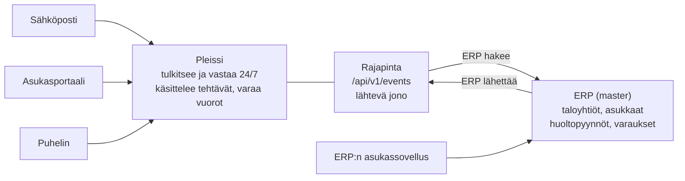

# Pleissi – integraatiospesifikaatio

Päivitetty 30.10.2026. Ajantasainen versio: https://claude.ai/artifact/TSzufk2YN7J3wqUDWVv8de (tämä tiedosto on vienti siitä).

## Tarkoitus ja laajuus

Pleissi tarjoaa oman integraatiorajapinnan, johon asiakkaan toiminnanohjausjärjestelmä (jatkossa ERP) lähettää tapahtumat ja josta se hakee Pleissin muutokset. ERP:n ei tarvitse tarjota omaa rajapintaa: riittää, että se osaa lähettää ja hakea JSON-sanomia HTTPS:n yli. Malli on sama kaikille ERP:ille, joten jokainen uusi integraatio käyttää samaa rajapintaa.

| Kokonaisuus | ERP → Pleissi (ERP lähettää) | Pleissi → ERP (ERP hakee) | Master |
| --- | --- | --- | --- |
| Taloyhtiöt ja asunnot | Perustiedot, muutokset | – | ERP |
| Asukkaat | Perustiedot, muutot | – | ERP |
| Varaukset | ERP:ssä tehdyt varaukset ja peruutukset | Pleississä tehdyt varaukset ja peruutukset | Jaettu kalenteri, ks. Varaukset |
| Tehtävät | ERP:n asukassovelluksen huoltopyynnöt | Tehtävän tila, käsittelijä ja asukkaalle näkyvät viestit | Pleissi (käsittely) |

**Ei kuulu laajuuteen:** laskutus, kirjanpito, vastikkeet, osakeluettelo ja huoltoyhtiön järjestelmät. Asukas- ja taloyhtiötietoja ei muokata Pleississä integraation alaisille yhtiöille, vaan muutokset tehdään ERP:hen.

**Pohja:** spec perustuu Pleissin koodiin (repo Pleissi-mega-ai, lokakuu 2026). Tehtävien ja kommenttien sanomamalli on jo toteutettu (server/src/integration); tilanne ja puuttuvat osat on koottu osioon Nykytila koodissa.

## Toteutuksen tila ja seuraavat askeleet

Tämä osio seuraa, mitä specistä on toteutettu ja mitä tehdään seuraavaksi. Muut osiot kuvaavat tavoitetilan; kun suunnitelma muuttuu, muutos kirjataan päätöslokiin alle ja osio päivitetään, jolloin historia säilyy. Päivitä tila-saraketta sitä mukaa kuin asiat valmistuvat.

| # | Tehtävä | Tila | Kuka | Huom |
| --- | --- | --- | --- | --- |
| 0 | Integraation 1. vaihe aiemmalla mallilla: jono, sanomamalli, adapteri ja simuloitu ERP, uudelleenyritykset, Integraatioloki | Valmis | Pleissi | Valmistui 26.10.2026; pohja kaikelle alla olevalle |
| 1 | Asukkaan puhelinkenttä ja tunnistus puhelinnumerolla | Ei aloitettu | Pleissi | Asukkaan tiedot, CSV-tuonti, tunnistus |
| 2 | Integraatiokysely Avaalle (REST, testiympäristö, kustannukset) | Odottaa muita | Avaa | Odotetaan vastausta; seuraavaksi ehdotetaan Pleissin rajapintamallia |
| 3 | ERP-tunnisteet: `integration_refs` laajennus taloyhtiöihin, asuntoihin, asukkaisiin ja varauksiin | Työn alla | Pleissi | Tehtäville ja kommenteille valmis |
| 4 | API-avaimet: taulu, oikeudet ja hallinta asetuksissa | Ei aloitettu | Pleissi |  |
| 5 | Vastaanotto `POST /api/v1/events` + vastaanottoloki (idempotenssi) | Ei aloitettu | Pleissi | Ensin taloyhtiöt ja asukkaat |
| 6 | Ensilataus `POST /api/v1/sync/housing-companies` | Ei aloitettu | Pleissi | Käyttää nykyistä tuontilogiikkaa |
| 7 | Jonoon kursori ja haku `GET /api/v1/events` | Työn alla | Pleissi | Jono on valmis, haku puuttuu |
| 8 | Tehtävät: ERP:n huoltopyyntöjen vastaanotto (`erp_app`, `reporter`), sanomiin `ticketNumber`, `sensitive` ja ERP-viittaukset | Työn alla | Pleissi | Tehtävien ja kommenttien julkaisu on valmis |
| 9 | Sisäiset muistiinpanot pois jonosta | Ei aloitettu | Pleissi | Nyt ne lähetetään sisäisinä kommentteina |
| 10 | Arkaluonteiset: oikea otsikko ja `sensitive: true` | Työn alla | Pleissi | Karsinta on valmis, otsikko on nyt "Arkaluonteinen tehtävä" |
| 11 | Varaukset molempiin suuntiin + päällekkäisyystarkistus | Ei aloitettu | Pleissi |  |
| 12 | Asukastietojen poisto myös vastaanottolokista | Työn alla | Pleissi | Jonon osalta valmis |
| 13 | Integraatiolokin oma käyttöoikeus ja uudelleenkäsittely käsin | Työn alla | Pleissi | Näkymä on valmis pääkäyttäjälle |
| 14 | Odotustila (`pending`) ja automaattinen uudelleenkäsittely puuttuvan viittauksen sanomille | Ei aloitettu | Pleissi | Liittyy kohtaan 5 |
| 15 | ERP:n hakukursorin seuranta per API-avain | Ei aloitettu | Pleissi | Liittyy kohtaan 7 |
| 16 | Hälytykset: haku pysähtynyt, jono kasvaa, hiljaisuus, hylätyt sanomat | Ei aloitettu | Pleissi | Adapterimallin epäonnistuneet lähetykset hälyttävät jo |
| 17 | Täsmäytys `POST /api/v1/reconcile` tehtäville ja varauksille | Ei aloitettu | Pleissi | Kohtien 8 ja 11 jälkeen |
| 18 | OpenAPI-dokumentaatio ja testiympäristö ERP-toimittajalle | Ei aloitettu | Pleissi | Annetaan Avaalle kohtien 4–8 jälkeen |
| 19 | ERP-puolen toteutus: lähetys, haku, varausten näyttö, uudelleenyritys, täsmäytys | Ei aloitettu | Avaa | Edellyttää kohtaa 18 |
| 20 | Tietojenkäsittelysopimus ja integraation tilaus | Odottaa muita | Hemman ja Pleissi | Asiakassopimusta ei vielä ole |

**Päätösloki**

| Päivä | Päätös tai muutos |
| --- | --- |
| 30.10.2026 | Spec ja tehtävälista päivitetty vastaamaan Pleissi-mega-ai-repon koodia (integraation 1. vaihe valmis 26.10.). Sanomissa pysyvät yleiset arvot (esim. in\_progress, critical, maintenance) ja tapahtuma task.comment.added; sisäisiä muistiinpanoja ei lähetetä ERP:hen. ERP:n huoltopyynnöissä mukana ilmoittajan nimi, sähköposti ja puhelin varatunnistusta varten; huoltopyyntö luodaan aina heti eikä jää odotustilaan. Lisätty myös epäonnistuneiden sanomien käsittely ja valvonta: odotustila, uudelleenkäsittely, hälytykset ja täsmäytys tehtäville ja varauksille. |
| 30.10.2026 | Varauksia voi tehdä molemmissa järjestelmissä (ERP:n asukasportaali sekä Pleissin sähköposti, puhelin ja portaali); molempien pitää tukea sitä. |
| 30.10.2026 | Arkaluonteisista tehtävistä ERP:lle lähetetään vain otsikko, tila, arkaluonteisuusmerkintä ja tunnisteet. |
| 30.10.2026 | Asukkaille lisätään puhelinkenttä. |
| 30.10.2026 | Malli vaihdettu: Pleissi tarjoaa rajapinnan, ERP lähettää tapahtumat ja hakee muutokset jonosta. Syy: Avaa.io:lla on vain pari suppeaa integraatioratkaisua. |
| 30.10.2026 | Spec päivitetty vastaamaan Pleissin nykyistä tietomallia (statukset, prioriteetit, tilat, viikkovuorot). |
| 26.10.2026 | Lisätty vaatimukset ERP-järjestelmälle ja tarkistuslista uuden ERP:n kartoitukseen. |
| 24.10.2026 | Asukastietojen synkka kerran vuorokaudessa; tapahtumaloki käyttäjäoikeuden taakse. |
| 24.10.2026 | Spec luotu ja tehty järjestelmäriippumattomaksi (ei viittauksia yksittäiseen ERP:hen tai asiakkaaseen). |

## Arkkitehtuuri ja periaatteet

Pleissi on se osapuoli, joka tarjoaa rajapinnan; ERP on asiakas, joka kutsuu sitä. ERP lähettää omat muutoksensa Pleissiin ja hakee Pleissin muutokset jonosta, eikä Pleissi koskaan kutsu ERP:tä.



Sähköposti, asukasportaali ja puhelin tulevat suoraan Pleissiin; ERP:n asukassovelluksen pyynnöt ja perustietojen muutokset ERP lähettää Pleissin rajapintaan.

1. **Pleissin rajapinta on sopimus.** Sanomien muoto on tämän dokumentin kanoninen JSON-malli. ERP-toimittaja tekee käännöksen omasta mallistaan tähän muotoon, Pleissi ei tee ERP-kohtaisia mäppäyksiä.
2. **Master päätetään per kokonaisuus.** Taloyhtiöt, asunnot ja asukkaat ovat ERP:n, ja Pleissi tallentaa niistä vain integraation tuoman kopion. Tehtävät käsitellään Pleississä, ja ERP saa niiden tilan jonosta. Mitään ei ylikirjoiteta toisen järjestelmän puolella.
3. **Tapahtumat, ei jättisanomaa.** Jokainen muutos on oma tapahtumansa (esim. `task.updated`), jossa on olion koko nykytila.
4. **Kaksi suuntaa, yksi rajapinta.** ERP → Pleissi: `POST /api/v1/events`. Pleissi → ERP: ERP hakee jonosta `GET /api/v1/events?after=<kursori>`.
5. **Ulkoiset ID:t talteen.** Jokaisella oliolla on Pleissin oma `id` ja `externalRefs.erp`, johon tallennetaan ERP:n tunniste. ERP voi viitata olioihin omilla tunnisteillaan.

| Suunta | Miten | ERP:ltä vaaditaan | Tahti |
| --- | --- | --- | --- |
| ERP → Pleissi | ERP kutsuu `POST /api/v1/events` heti muutoksen tapahduttua | HTTPS-kutsu ja JSON, API-avain, uudelleenyritys virheen sattuessa | Heti |
| Pleissi → ERP | ERP hakee uudet tapahtumat jonosta kursorilla | Ajastettu haku, viimeisen kursorin tallennus | Tehtävät ja varaukset 1–2 min välein |
| Ensilataus | ERP lähettää taloyhtiöt, asunnot ja asukkaat kerralla `POST /api/v1/sync/housing-companies` | Massavienti omasta järjestelmästä | Kerran käyttöönotossa, sitten tarvittaessa (esim. yöllä) |

**Lähtevä jono (outbox).** Pleissi kirjoittaa jokaisen ERP:lle näkyvän muutoksen jonoon samassa transaktiossa kuin itse muutoksen. Jono on erillinen taulu nykyisestä toimintalokista (`audit_log`), joka jää ennalleen käyttäjille näkyväksi historiaksi. Jonon ansiosta mikään muutos ei katoa, vaikka ERP olisi hetken tavoittamattomissa, ja myöhemmin samat tapahtumat voidaan lähettää myös webhookeina.

**Pääsy jonoon ja lokiin:** jonon ja vastaanotettujen sanomien loki näkyy Pleississä omana näkymänään vain erikseen annetulla oikeudella (esim. rooli "Integraatioloki: luku"). Oletuksena oikeus on vain Pleissin ylläpidolla ja asiakkaan pääkäyttäjällä, ja lokin katselu kirjataan, koska sanomissa on henkilötietoja.

## Pleissin integraatiorajapinta

Rajapinnassa on neljä endpointtia, ja ERP pärjää kahdella: tapahtumien lähetys ja jonon haku. Kaikki kutsut ovat asiakaskohtaisia: API-avain määrää, minkä isännöintitoimiston dataa kutsu koskee.

| Endpoint | Kuka kutsuu | Mitä tekee | Vastaus |
| --- | --- | --- | --- |
| `POST /api/v1/events` | ERP | Vastaanottaa 1–100 tapahtumaa (taloyhtiö, asunto, asukas, varaus, huoltopyyntö) | `202 Accepted` + tulos per tapahtuma |
| `GET /api/v1/events?after=<kursori>&limit=100` | ERP | Palauttaa Pleissin tapahtumat järjestyksessä annetun kursorin jälkeen | `200 OK` + tapahtumat + `nextCursor` |
| `POST /api/v1/sync/housing-companies` | ERP | Ensilataus ja täysi täsmäytys: taloyhtiöt, asunnot ja asukkaat kerralla | `202 Accepted` + yhteenveto (lisätty, päivitetty, poismuuttaneeksi merkitty) |
| `GET /api/v1/tasks/{id}` | ERP | Yksittäisen tehtävän nykytila (Pleissin tai ERP:n tunnisteella) | `200 OK` + tehtävä |

**Lähetys (ERP → Pleissi)**

```
POST https://api.pleissi.fi/api/v1/events
Authorization: Bearer plk_live_8f3k...
Content-Type: application/json

{ "events": [ { "eventId": "erp-evt-77812", "eventType": "task.created", ... } ] }
```

```json
{
  "results": [
    { "eventId": "erp-evt-77812", "status": "accepted", "pleissiId": "tkt_9f2c" }
  ]
}
```

Tulos per tapahtuma on `accepted`, `duplicate` (sama `eventId` jo käsitelty, ei tehdä uudelleen) tai `rejected` + syy. Hylättyä tapahtumaa ei kannata lähettää uudelleen sellaisenaan; verkkovirheen tai `5xx`-vastauksen jälkeen ERP lähettää saman sanoman uudelleen samalla `eventId`:llä.

**Haku jonosta (Pleissi → ERP)**

```
GET https://api.pleissi.fi/api/v1/events?after=c_000041&limit=100
Authorization: Bearer plk_live_8f3k...
```

```json
{
  "events": [ { "eventId": "evt_01HZXB7RPD", "eventType": "task.updated", "cursor": "c_000042", ... } ],
  "nextCursor": "c_000042",
  "hasMore": false
}
```

ERP tallentaa `nextCursor`-arvon ja käyttää sitä seuraavassa haussa. Jono pitää tapahtumat tallessa säilytysajan (ehdotus 30 päivää), joten ERP:n katko ei hukkaa mitään. Kursori ei vanhene; jos ERP haluaa aloittaa alusta, se hakee ilman `after`-parametria.

**Ensilataus ja täsmäytys**

`POST /api/v1/sync/housing-companies` ottaa vastaan yhden tai useamman taloyhtiön kaikkine asuntoineen ja asukkaineen (sama rakenne kuin `housingCompany.upserted` ja `resident.upserted`). Pleissi lisää uudet, päivittää muuttuneet ja merkitsee poismuuttaneiksi ne yhtiön asukkaat, jotka puuttuvat listasta. Sama kutsu korvaa nykyisen CSV- tai Excel-tuonnin integraation alaisille yhtiöille.

## Sanomakuori ja yhteiset säännöt

Jokainen sanoma on samassa kuoressa molempiin suuntiin: kuori kertoo mitä tapahtui, milloin ja kuka sen teki, ja `data` sisältää olion koko nykytilan.

```json
{
  "eventId": "evt_01HZX8K2M4",
  "eventType": "task.updated",
  "schemaVersion": "1.0",
  "occurredAt": "2026-10-30T10:45:00+02:00",
  "source": "pleissi",
  "sequence": 42,
  "cursor": "c_000042",
  "data": { }
}
```

| Kenttä | Merkitys |
| --- | --- |
| `eventId` | Uniikki tunniste. Lähettäjä luo sen; vastaanottaja ohittaa saman ID:n toiseen kertaan. |
| `eventType` | `<olio>.<tapahtuma>`, esim. `booking.created`. Lista alla. |
| `schemaVersion` | Sanomamallin versio. Kenttiä voi lisätä ilman versionnostoa; poisto tai merkityksen muutos nostaa pääversiota ja rajapinnan polun (`/api/v2`). |
| `occurredAt` | Milloin muutos tapahtui, ISO 8601 aikavyöhykkeellä. |
| `source` | Kuka muutoksen teki: `pleissi` tai `erp`. ERP ohittaa jonosta omat muutoksensa, mikä estää synkkasilmukat. |
| `sequence` | Juokseva numero per olio. Vanhempi sanoma ei koskaan ylikirjoita uudempaa. |
| `cursor` | Vain jonosta haetuissa: tapahtuman paikka jonossa. |

Pleissin julkaisemissa sanomissa on lisäksi tenantId (asiakas eli isännöintitoimisto). ERP:n lähettämissä sanomissa sitä ei tarvita, koska asiakas päätellään API-avaimesta.

**Tapahtumatyypit**

| Olio | ERP → Pleissi | Pleissi → ERP |
| --- | --- | --- |
| Taloyhtiö ja asunnot | `housingCompany.upserted`, `housingCompany.deleted` | – |
| Asukas | `resident.upserted`, `resident.moved_out` | – |
| Varaus | `booking.created`, `booking.cancelled` | `booking.created`, `booking.cancelled` |
| Tehtävä | `task.created` (huoltopyyntö ERP:n sovelluksesta), `task.comment.added` (asukkaan lisäviesti) | `task.created`, `task.updated` |
| Viesti | – | `task.comment.added` |

**Yhteiset säännöt**

- Kenttänimet englanniksi camelCasena (`housingCompany`, `startsAt`).
- Ajat ISO 8601 -muodossa offsetin kanssa (`2026-10-31T20:00:00+02:00`). Pleissi tallentaa ajat UTC:na, kuten nykyisin.
- Puhelinnumerot E.164-muodossa (`+358401234567`), sähköpostit pienillä kirjaimilla.
- Puuttuva arvo on `null`, ei tyhjä merkkijono.
- Jokaisessa oliossa `id` (Pleissin, ERP:n lähettämässä sanomassa saa puuttua) ja `externalRefs.erp` (ERP:n tunniste, pakollinen ERP:n lähettämissä).

## Taloyhtiöt

ERP lähettää taloyhtiöt ja niiden asunnot. Pleissi tarvitsee ne, jotta yhteydenotto ja varaus voidaan kohdistaa oikeaan yhtiöön ja asuntoon, ja jotta tehtävä ohjautuu vastuuisännöitsijälle.

- **Suunta:** ERP → Pleissi (`housingCompany.upserted` muutoksista, `sync` ensilatauksessa)
- **Käyttö Pleississä:** tehtävän kohdistus, vastuuisännöitsijä, huoltoyhtiön yhteystiedot, varattavat tilat
- **Pleissin taulut:** `companies` ja `apartments`

```json
{
  "eventId": "erp-evt-50121",
  "eventType": "housingCompany.upserted",
  "schemaVersion": "1.0",
  "occurredAt": "2026-10-30T09:00:00+02:00",
  "source": "erp",
  "data": {
    "externalRefs": { "erp": "ERP-HC-1182" },
    "name": "As Oy Koivikko",
    "businessId": "1234567-8",
    "email": "koivikko@isannointi.example",
    "phone": "+358201234567",
    "propertyManager": { "email": "isannoitsija@isannointi.example" },
    "maintenance": {
      "name": "Huoltoyhtiö Oy",
      "phone": "+358207654321",
      "email": "huolto@huolto.example",
      "emergencyPhone": "+358201112223"
    },
    "apartments": [
      { "externalRefs": { "erp": "ERP-APT-5521" }, "apartmentNumber": "B 8", "staircase": "B", "address": "Koivukuja 4 B 8, 01600 Vantaa" },
      { "externalRefs": { "erp": "ERP-APT-5522" }, "apartmentNumber": "B 9", "staircase": "B", "address": "Koivukuja 4 B 9, 01600 Vantaa" }
    ]
  }
}
```

| Kenttä | Pakollinen | Pleississä | Huom |
| --- | --- | --- | --- |
| `name` | Kyllä | `companies.name` |  |
| `email` | Kyllä | `companies.email_address` | Yhtiön sähköposti, jolla Pleissi tunnistaa yhtiölle tulevat viestit |
| `phone`, `maintenance.*` | Ei | `companies.phone`, `maintenance_*` | Huoltoyhtiön tiedot näkyvät tehtävällä ja työtilauksissa |
| `propertyManager.email` | Ei | `companies.manager_id` | Kohdistetaan Pleissin käyttäjään sähköpostilla; uusi tehtävä ohjautuu hänelle |
| `businessId` | Ei | Uusi kenttä | Hyvä täsmäytysavain ensilatauksessa |
| `apartments[].apartmentNumber` | Kyllä | `apartments.apartment_number` |  |
| `apartments[].staircase` | Ei | `apartments.staircase` | Tiedotteiden kohdistus rapuittain |
| `apartments[].address` | Kyllä | `apartments.address` |  |

Varattavat tilat ja niiden säännöt (kerta- vai viikkovuorot, hinnat, jono) määritellään Pleississä taloyhtiön asetuksissa, ei integraatiossa.

## Asukkaat

Asukastiedoilla Pleissi tunnistaa, kuka ottaa yhteyttä ja mihin asuntoon pyyntö kuuluu. Minimi on nimi, sähköposti, puhelin ja asunto.

- **Suunta:** ERP → Pleissi (`resident.upserted` heti muutoksesta, `resident.moved_out` muutosta, täysi lista `sync`-kutsulla)
- **Käyttö Pleississä:** yhteydenoton tunnistus, tehtävän asukas, varaajan tunnistus, asukasportaalin tunnus
- **Pleissin taulu:** `residents`
- Asukas ilmoittaa Pleissiin uuden puhelinnumeron → Pleissi tekee tehtävän isännöitsijälle päivittää tieto ERP:hen, eikä muuta tietoa itse.

```json
{
  "eventId": "erp-evt-50177",
  "eventType": "resident.upserted",
  "schemaVersion": "1.0",
  "occurredAt": "2026-10-30T09:05:00+02:00",
  "source": "erp",
  "data": {
    "externalRefs": { "erp": "ERP-R-90311" },
    "housingCompanyRef": "ERP-HC-1182",
    "apartmentRef": "ERP-APT-5521",
    "name": "Liisa Mattila",
    "email": "liisa.mattila@example.com",
    "phone": "+358401234567",
    "roles": ["asukas"],
    "movedInAt": "2025-06-01",
    "movedOutAt": null
  }
}
```

| Kenttä | Pakollinen | Pleississä | Huom |
| --- | --- | --- | --- |
| `name` | Kyllä | `residents.name` | Yksi kenttä, kuten nykyisin |
| `email` | Kyllä\* | `residents.email` | \*Vähintään toinen: sähköposti tai puhelin |
| `phone` | Kyllä\* | Uusi kenttä | Normalisoidaan E.164-muotoon |
| `housingCompanyRef`, `apartmentRef` | Kyllä | `company_id`, `apartment_id` | ERP:n tunnisteet; Pleissi etsii vastaavan rivin `externalRefs`-tiedon avulla |
| `roles` | Kyllä | `residents.roles` | `asukas`, `osakas` tai molemmat |
| `movedOutAt` | Ei | `residents.moved_out_at` | Poismuuttanut jää historiaan eikä voi varata |
| `movedInAt` | Ei | Uusi kenttä |  |

**Tunnistuslogiikka** (nykyinen sovellus tunnistaa asukkaan sähköpostista; puhelin lisätään)

1. Sähköposti tai puhelin löytyy yhdeltä yhtiössä asuvalta asukkaalta → tunnistettu.
2. Ei löydy → AI kysyy nimen ja asunnon ja tarkistaa ne asukastiedoista.
3. Löytyy usealta (esim. pariskunnan yhteinen osoite) → AI pyytää tarkennuksen.
4. Ristiriita (osoite on eri asunnossa kuin kerrottu) → ei varausta, tehtävä isännöitsijälle.

Asukastiedot ovat henkilötietoja. Pleissiin tuodaan vain yllä olevat kentät, ja nykyinen asukkaan tietojen poisto (anonymisointi) koskee myös integraatiojonoa ja vastaanotettujen sanomien lokia.

## Varaukset

Varauksia voi tehdä molemmissa järjestelmissä, ja molempien pitää tukea sitä: asukas varaa ERP:n asukasportaalista, ja Pleissi varaa sähköpostin, puhelimen tai Pleissin asukasportaalin kautta. Molemmat välittävät varauksensa ja peruutuksensa toisilleen, jotta kalenteri on sama kummassakin.

- **ERP → Pleissi:** ERP lähettää sovelluksessa tehdyt varaukset ja peruutukset heti (`booking.created`, `booking.cancelled`)
- **Pleissi → ERP:** ERP hakee Pleississä tehdyt varaukset ja peruutukset jonosta
- **Pleissin taulu:** `bookings`; tilat nykyisin `sauna` ja `laundry` (pesutupa)
- **AI:n toiminta:** tarkistaa vapaan vuoron Pleissin kalenterista, johon ERP:n varaukset on jo tuotu, varaa ja vahvistaa asukkaalle heti

**Kertavaraus**

```json
{
  "eventId": "evt_01J0A4MZ7K",
  "eventType": "booking.created",
  "schemaVersion": "1.0",
  "occurredAt": "2026-10-30T11:02:00+02:00",
  "source": "pleissi",
  "sequence": 1,
  "cursor": "c_000057",
  "data": {
    "id": "bkg_7f21",
    "externalRefs": { "erp": null },
    "housingCompanyRef": "ERP-HC-1182",
    "residentRef": "ERP-R-90311",
    "resource": "laundry",
    "startsAt": "2026-11-04T18:00:00+02:00",
    "endsAt": "2026-11-04T21:00:00+02:00",
    "seriesId": null,
    "note": "",
    "createdBy": "ai",
    "channel": "email"
  }
}
```

**Viikkovuoro.** Pleissi tallentaa viikoittain toistuvan vuoron erillisinä varauksina, joilla on sama `seriesId`, ja varaa ne taloyhtiön asetuksen mukaiselle viikkomäärälle kerrallaan. Integraatiossa jokainen vuoro on oma `booking.created`-tapahtumansa samalla `seriesId`:llä. Näin kesäaika ja yksittäisen vuoron peruutus toimivat ilman toistosääntöjä, ja ERP voi näyttää sarjan yhtenä, jos haluaa.

**Peruutus** on `booking.cancelled`, jossa on peruttavan varauksen tunnisteet. Peruutus tehdään samaa reittiä kuin varaus, ettei asukasta ohjata toiseen järjestelmään perumaan.

**Päällekkäiset varaukset.** Koska varauksia tehdään kahdessa paikassa, sama vuoro voidaan varata molemmissa muutaman sekunnin sisällä. Sääntö: aiemmin tehty varaus (`occurredAt`) voittaa. Jos ERP:n lähettämä varaus osuu Pleississä jo varattuun vuoroon, Pleissi vastaa `rejected` + `slot_taken`, ja ERP ilmoittaa asukkaalleen. Jos Pleissin varaus häviää, AI ilmoittaa asukkaalle ja tarjoaa seuraavaa vapaata. Varaukset lähetetään heti ja haetaan 1–2 minuutin välein, joten päällekkäisyys on harvinainen.

Nykyiset vuorotoiveet (`booking_requests`) ja jonot (`booking_queue`) jäävät Pleissin sisäisiksi; ERP näkee niistä vain lopputuloksen eli varauksen.

## Tehtävät

Kaikki asukkaiden yhteydenotot käsitellään Pleississä. ERP lähettää sovelluksensa huoltopyynnöt Pleissiin, ja Pleissi julkaisee jokaisen tehtävän tilan jonoon, jotta asukas näkee pyyntönsä tilan myös ERP:n sovelluksessa.

- **ERP → Pleissi:** `task.created`, kun asukas tekee huoltopyynnön ERP:n sovelluksessa; `task.comment.added`, kun asukas kirjoittaa siihen lisää
- **Pleissi → ERP:** `task.created` sähköpostista, portaalista tai puhelimesta tulleista tehtävistä, `task.updated` jokaisesta muutoksesta ja `task.comment.added` asukkaalle näkyvistä viesteistä
- **Pleissin taulut:** `tickets` (tehtävä), `messages` (viestit), `ticket_notes` (sisäiset muistiinpanot), `attachments`
- **Koodi:** sanomamalli `server/src/integration/canonical.ts`, Pleissin arvojen käännös `mapping.ts`

**ERP:n lähettämä huoltopyyntö**

```json
{
  "eventId": "erp-evt-77812",
  "eventType": "task.created",
  "schemaVersion": "1.0",
  "occurredAt": "2026-10-30T18:52:10+02:00",
  "source": "erp",
  "data": {
    "externalRefs": { "erp": "ERP-T-44120" },
    "housingCompanyRef": "ERP-HC-1182",
    "apartmentRef": "ERP-APT-5521",
    "residentRef": "ERP-R-90311",
    "reporter": {
      "name": "Liisa Mattila",
      "email": "liisa.mattila@example.com",
      "phone": "+358401234567"
    },
    "title": "Keittiön hana vuotaa",
    "description": "Keittiön hanasta tippuu vettä jatkuvasti, myös kun se on kiinni.",
    "category": "maintenance",
    "attachments": [
      { "fileName": "hana.jpg", "contentType": "image/jpeg", "url": "https://erp.example/files/a/8c1e" }
    ]
  }
}
```

Pleissi käsittelee tämän kuten muunkin saapuvan yhteydenoton: tunnistaa asukkaan, arvioi prioriteetin ja hätätapauksen, liittää saman ketjun viestit samaan tehtävään ja ohjaa tehtävän vastuuisännöitsijälle. Kanavaksi tallentuu `erp_app`. Liitteet Pleissi hakee annetusta osoitteesta ja tarkistaa samoin kuin sähköpostin liitteet.

**Huoltopyyntö ei koskaan jää odottamaan.** Asukas tunnistetaan järjestyksessä: ensin `residentRef`, sitten `reporter`-tietojen sähköposti tai puhelin samalla logiikalla kuin muissa yhteydenotoissa. Jos kumpikaan ei tunnista asukasta tai taloyhtiöä ei vielä ole Pleississä, tehtävä luodaan silti heti ilman asukasta, merkitään tunnistamattomaksi ja ohjataan isännöitsijän päätösjonoon. Asukas liitetään tehtävään automaattisesti, kun puuttuva tieto saapuu. `reporter` on pakollinen siinä tapauksessa, että `residentRef` puuttuu.

**Pleissin julkaisema tehtävä (jonossa)**

```json
{
  "eventId": "evt_01HZX9A1QT",
  "eventType": "task.created",
  "schemaVersion": "1.0",
  "occurredAt": "2026-10-30T18:52:14+02:00",
  "source": "pleissi",
  "tenantId": "asiakas-001",
  "sequence": 1,
  "cursor": "c_000063",
  "data": {
    "id": "tkt_9f2c",
    "externalRefs": { "erp": "ERP-T-44120" },
    "ticketNumber": 412,
    "housingCompanyRef": "ERP-HC-1182",
    "apartmentRef": "ERP-APT-5521",
    "residentRef": "ERP-R-90311",
    "title": "Keittiön hana vuotaa",
    "description": "Keittiön hana vuotaa jatkuvasti.",
    "category": "maintenance",
    "priority": "high",
    "status": "open",
    "channel": "erp_app",
    "assignee": { "type": "propertyManager", "name": "Isännöitsijän nimi" },
    "sensitive": false,
    "attachments": [],
    "commentCount": 0,
    "createdAt": "2026-10-30T18:52:14+02:00",
    "updatedAt": "2026-10-30T18:52:14+02:00"
  }
}
```

Sanomissa käytetään yleisiä, järjestelmäriippumattomia arvoja. Pleissi kääntää omat arvonsa niihin (`mapping.ts`), ja ERP kääntää ne omiinsa.

| Kenttä | Sanoman arvot | Pleissin arvo → sanoman arvo |
| --- | --- | --- |
| `status` | `open`, `in_progress`, `waiting_resident`, `waiting_contractor`, `resolved`, `closed` | Uusi ja Avoin → `open`, Käsittelyssä → `in_progress`, Vastattu → `waiting_resident`, Kolmannella osapuolella → `waiting_contractor`, Suljettu → `closed`. `resolved` ei vielä käytössä. |
| `priority` | `low`, `normal`, `high`, `urgent`, `critical` | Hätä → `critical`, Kiireellinen → `high`, Normaali → `normal`, Matala → `low` |
| `category` | `maintenance`, `booking`, `question`, `complaint`, `other` | Vikailmoitus → `maintenance`, Häiriöilmoitus ja Valitus → `complaint`, Kysymys → `question`, varausaiheet → `booking`, muut → `other` |
| `channel` | `email`, `phone`, `erp_app`, `web_form`, `manual` | Sähköposti → `email`, asukasportaali → `web_form`, toimiston kirjaama → `manual`, ERP:n sovellus → `erp_app` |
| `assignee.type` | `ai`, `propertyManager`, `maintenance` | AI hoitaa → `ai`, huoltoyhtiöllä työtilaus → `maintenance`, muuten `propertyManager` |
| `ticketNumber` | Juokseva numero taloyhtiöittäin | Näkyy asukkaalle viesteissä |
| `sensitive` | `true` / `false` | Ks. arkaluonteiset tehtävät alla |

AI:n suodattamat viestit ja remontti-ilmoitukset eivät mene jonoon. Tunnistamaton Pleissin tehtävä julkaistaan vasta, kun sen taloyhtiö on valittu.

## Tehtävien päivitykset ja kommentit

Jokaisesta tehtävän muutoksesta syntyy jonoon uusi `task.updated`, jossa on tehtävän koko nykytila (snapshot). Asukkaalle näkyvät viestit kulkevat omina `task.comment.added`-tapahtuminaan, eikä niitä sisällytetä tehtävän tilaan.

**Miksi koko snapshot eikä pelkkä muutos**

- ERP:n ei tarvitse tietää edellistä tilaa: viimeisin tapahtuma on aina totuus.
- Kadonnut tai tuplahaku ei riko mitään; `sequence` kertoo, kumpi on uudempi.
- `changedFields` kertoo silti, mikä muuttui, jos ERP haluaa reagoida vain esim. statukseen.
- Saman tehtävän peräkkäisistä muutoksista voidaan julkaista vain uusin; vanhemmat merkitään ohitetuiksi, ja uusimman `changedFields` sisältää kaikkien yhdistettyjen muutosten kentät.

```json
{
  "eventId": "evt_01HZXB7RPD",
  "eventType": "task.updated",
  "schemaVersion": "1.0",
  "occurredAt": "2026-10-30T19:10:42+02:00",
  "source": "pleissi",
  "tenantId": "asiakas-001",
  "sequence": 3,
  "cursor": "c_000071",
  "changedFields": ["status", "assignee"],
  "data": { "id": "tkt_9f2c", "externalRefs": { "erp": "ERP-T-44120" }, "status": "waiting_contractor", "...": "muut kentät kuten task.created" }
}
```

**Mitä kommentteja ERP saa**

| Sisältö Pleississä | Lähteekö ERP:lle | Tapahtuma |
| --- | --- | --- |
| Vastaus asukkaalle (AI:n tai isännöitsijän lähettämä) | Kyllä, näkyy asukkaalle ERP:n sovelluksessa | `task.comment.added`, `visibility: public` |
| Asukkaan viesti sähköpostista tai portaalista | Kyllä | `task.comment.added`, `visibility: public` |
| Isännöitsijän sisäinen muistiinpano (`ticket_notes`) | Ei | – |
| Viestit huoltoyhtiölle ja työtilaukset | Ei | – |
| AI:n vastausluonnokset ja perustelut | Ei koskaan | – |
| Toimintaloki (`audit_log`) | Ei | – |

```json
{
  "eventId": "evt_01HZXB9W2K",
  "eventType": "task.comment.added",
  "schemaVersion": "1.0",
  "occurredAt": "2026-10-30T19:11:05+02:00",
  "source": "pleissi",
  "tenantId": "asiakas-001",
  "cursor": "c_000072",
  "data": {
    "id": "cmt_88",
    "externalRefs": { "erp": null },
    "taskId": "tkt_9f2c",
    "taskRef": "ERP-T-44120",
    "author": { "type": "ai", "name": "Pleissi" },
    "visibility": "public",
    "text": "Kiitos ilmoituksesta. Huolto on tilattu ja käy huomenna klo 10.",
    "createdAt": "2026-10-30T19:11:05+02:00"
  }
}
```

`author.type` on `ai`, `propertyManager` tai `resident`. AI:n kirjoittamat kommentit merkitään aina `ai`, jotta niitä ei tulkita isännöitsijän omiksi vastauksiksi. Kun asukas vastaa ERP:n sovelluksessa, ERP lähettää sen `task.comment.added`-tapahtumana (`author.type: resident`), ja Pleissi avaa vastatun tai suljetun tehtävän uudelleen samalla säännöllä kuin sähköpostivastauksessa.

**Arkaluonteiset tehtävät.** Pleissi merkitsee terveys- ja muita erityisiä tietoja sisältävät tehtävät arkaluonteisiksi, ja niiden sisältöä näkee vain rajattu joukko. Integraatiossa niistä lähetetään vain otsikko (`title`), tila (`status`), arkaluonteisuusmerkintä (`sensitive: true`) sekä tunnisteet (`id`, `externalRefs`, `ticketNumber`). Kuvausta, käsittelijää, liitteitä ja kommentteja ei julkaista jonoon. Isännöitsijän kannattaa tarkistaa, ettei otsikko itsessään paljasta arkaluonteista tietoa.

## Virheenkäsittely, tietoturva ja lokitus

Pleissi vastaa jokaiseen kutsuun heti, ja ERP huolehtii omasta uudelleenyrityksestään. Koska `eventId` tekee lähetyksestä idempotentin, saman sanoman voi aina lähettää uudelleen turvallisesti.

| Pleissin vastaus | Merkitys | ERP tekee |
| --- | --- | --- |
| `202 Accepted` | Vastaanotettu; tulos per tapahtuma vastauksessa | Tarkistaa `rejected`-rivit |
| `400 Bad Request` | Kuori tai JSON virheellinen | Korjaa sanoman, ei uudelleenyritystä sellaisenaan |
| `401` / `403` | API-avain puuttuu, vanhentunut tai oikeus puuttuu | Tarkistaa avaimen |
| `413` | Liian monta tapahtumaa yhdessä kutsussa (yli 100) | Jakaa pienempiin osiin |
| `429` | Kutsuja liian tiheään | Odottaa `Retry-After`-ajan |
| `5xx` | Katko Pleissin päässä | Uudelleenyritys kasvavin välein (1 min, 5 min, 30 min) samalla `eventId`:llä |

Yleisimmät `rejected`-syyt: `unknown_reference` (viitattu taloyhtiö, asunto tai asukas puuttuu Pleissistä; lähetä ensin perustiedot), `slot_taken` (varaus päällekkäin), `validation_error` (kenttä puuttuu tai väärä muoto; syy kertoo kentän).

**Synkkasilmukan esto:** ERP ohittaa jonosta tapahtumat, joiden `source` on `erp`, ja Pleissi ei julkaise jonoon uudelleen ERP:ltä tullutta tietoa sellaisenaan (esim. asukkaan perustietoja).

**Tietoturva**

- API-avaimet asiakaskohtaisesti, muotoa `plk_live_...`. Pleissi tallentaa avaimesta vain tiivisteen, ja avaimen voi vaihtaa ja mitätöidä Pleissin asetuksista ilman koodimuutosta.
- Avaimelle oikeudet (scopes): esim. `events:write`, `events:read`, `sync:write`. Avain näkee vain oman toimistonsa yhtiöt, kuten nykyinen yhtiökohtainen näkyvyys.
- Vapaaehtoisesti HMAC-allekirjoitus lähetyksiin (`X-Signature: t=…,v1=…`, aikaleima enintään 5 min vanha) API-avaimen lisäksi.
- Liikenne vain HTTPS:n yli, data EU/ETA-alueella. Rajapinnalle oma pyyntöjen rajoitus, kuten nykyisellä `/api`-reitillä.
- Liitteiden osoitteista haetaan vain HTTPS-tiedostot sallituista verkkotunnuksista, ja ne tarkistetaan samoin kuin sähköpostin liitteet.
- AI-mallille lähetetään vain käsittelyyn tarvittava data samoilla säännöillä kuin nykyisin (maskaus, arkaluonteiset eivät mene AI:lle).
- Isännöintitoimisto on rekisterinpitäjä ja Pleissi käsittelijä: tarvitaan tietojenkäsittelysopimus (DPA).

**Lokitus:** jokaisesta vastaanotetusta ja haetusta sanomasta tallennetaan `eventId`, suunta, aikaleima, tulos ja virheen syy. Sanomien henkilötiedot eivät päädy sovelluslokeihin.

## Epäonnistuneet sanomat ja valvonta

Mikään sanoma ei saa kadota huomaamatta: jokainen vastaanotettu sanoma tallentuu tuloksineen, epäonnistuneet käsitellään uudelleen, ja Pleissi hälyttää, jos sanomia jää tulematta tai hakematta.

**ERP → Pleissi**

| Tilanne | Mitä tapahtuu | Missä näkyy |
| --- | --- | --- |
| Sanoma ei tule perille (verkkovirhe, ERP:n katko) | ERP ei saa `202`-vastausta ja lähettää uudelleen samalla `eventId`:llä. ERP:n vastuulla on oma lähtevä jono. | Pleissi ei näe sitä; kiinni jää täsmäytyksessä ja hiljaisuushälytyksessä |
| Viitattu tieto puuttuu vielä (esim. asukas ennen taloyhtiötään) | Tila `pending`. Pleissi yrittää uudelleen automaattisesti, kun puuttuva tieto saapuu, enintään 24 tuntia; sen jälkeen `rejected` + `unknown_reference`. Koskee perustietoja ja varauksia; huoltopyynnöt luodaan aina heti (ks. Tehtävät) | Vastaanottoloki, integraatiolokin näkymä |
| Sanoma virheellinen | `rejected` + syy heti vastauksessa | Vastaanottoloki, hälytys |
| Pleissin oma virhe (`5xx`) | ERP yrittää uudelleen; tuplat estää `eventId` | Vastaanottoloki, palvelimen loki, hälytys |

**Vastaanottoloki** (`integration_inbox`) tallentaa jokaisesta sanomasta `eventId`:n, tyypin, ajan, tuloksen, syyn, yritysten määrän ja koko sanoman. Epäonnistuneen sanoman voi käsitellä uudelleen lokinäkymästä virheen korjaamisen jälkeen. Koko sanoma säilytetään 30 päivää (henkilötietoja), tulosrivi pidempään ilman sisältöä.

**Pleissi → ERP**

- Tapahtumat odottavat jonossa 30 päivää; ERP jatkaa kursorista, mihin jäi.
- ERP siirtää kursoria vasta onnistuneen käsittelyn jälkeen. Jos käsittely kaatuu, ERP hakee uudelleen vanhemmasta kursorista tai tarkistaa nykytilan `GET /api/v1/tasks/{id}`.
- Pleissi tallentaa jokaisen API-avaimen viimeisimmän haetun kursorin ja ajan, joten se näkee, kuinka paljon ERP on jäljessä.

**Hälytykset**

| Hälytys | Ehto (oletus, säädettävissä) | Kenelle |
| --- | --- | --- |
| ERP ei hae jonoa | Ei hakua 15 minuuttiin | Pleissin ylläpito |
| Jono kasvaa | Yli 500 hakematonta tapahtumaa tai vanhin yli 1 tunti | Pleissin ylläpito |
| Tapahtumia vanhenemassa | Hakematon tapahtuma yli 25 päivää vanha | Pleissin ylläpito ja asiakkaan pääkäyttäjä |
| Hiljaisuus ERP:ltä | Ei yhtään tapahtumaa 4 tuntiin arkipäivisin klo 8–20 | Pleissin ylläpito |
| Hylätyt sanomat | Mikä tahansa `rejected` | Pleissin ylläpito ja asiakkaan pääkäyttäjä (päiväkooste) |
| Asukkaan pyyntö jäi käsittelemättä | Hylätty `task.created` tai `task.comment.added` | Lisäksi vastuuisännöitsijä |

**Täsmäytys.** Asukkaat ja taloyhtiöt korjaantuvat yöllisellä `sync`-kutsulla. Tehtäville ja varauksille ERP lähettää kerran vuorokaudessa listan avoimista huoltopyynnöistä ja tulevista varauksista (vain tunnisteet ja muutosaika) kutsulla `POST /api/v1/reconcile`, ja Pleissi palauttaa erot: mitä ERP:llä on mutta Pleissiltä puuttuu ja päinvastoin. Puuttuvat ERP lähettää uudelleen, ja Pleissin puolella puuttuvat näkyvät hälytyksenä.

## Nykytila koodissa ja tarvittavat muutokset

Integraation ensimmäinen vaihe on toteutettu 26.10.2026 aiemman mallin mukaan: Pleissi kirjaa tehtävät ja kommentit lähtevään jonoon ja lähettää ne ERP:hen adapterin kautta (oikean ERP:n sijaan simuloitu testiversio). Jono ja sanomamalli käyvät sellaisenaan uuteen malliin, jossa ERP hakee jonosta; adapteri jää valmiiksi niille ERP:ille, joilla on oma rajapinta.

**Jo toteutettu** (`server/src/integration`)

| Osa | Koodi | Huom |
| --- | --- | --- |
| Kanoninen sanomamalli (kuori, taloyhtiö, asukas, varaus, tehtävä, kommentti) | `canonical.ts` | Tehtävä ja kommentti käytössä; muut skeemat päivitettävä tämän specin mukaisiksi |
| Pleissin arvojen käännös yleisiin arvoihin | `mapping.ts` | Ks. arvotaulukko osiossa Tehtävät |
| Lähtevä jono `integration_outbox` | `outbox.ts` | Kirjaus tietokantatriggerillä samassa transaktiossa kuin muutos; tilat pending, sent, failed, superseded |
| ERP-tunnisteet `integration_refs` | `outbox.ts` | Erillinen taulu sarakkeiden sijaan; laajennetaan taloyhtiöihin, asuntoihin, asukkaisiin ja varauksiin |
| ERP-adapterin rajapinta ja simuloitu ERP | `adapter.ts`, `mock-adapter.ts` | Asetus `INTEGRATION_ADAPTER` (tyhjä = pois, `mock` = simuloitu) |
| Lähetys, yhdistäminen ja uudelleenyritykset | `dispatcher.ts` | 1, 5 ja 30 min; epäonnistuessa merkintä tehtävän historiaan ja sähköposti vastuuisännöitsijälle |
| Integraatioloki-näkymä | Asetukset › Tietoturva › Integraatioloki | Vain pääkäyttäjä; sanoman avaus kirjataan toimintalokiin |
| Asukastietojen poisto jonosta | `resident-erasure` | Myös jo lähetetyt sanomat anonymisoidaan |

**Muutettava, jotta koodi vastaa tätä speciä**

| Muutos | Miksi |
| --- | --- |
| Sisäiset muistiinpanot pois jonosta (nyt `task.comment.added`, `visibility: internal`) | Päätös 30.10.: muistiinpanoja ei lähetetä ERP:hen |
| Arkaluonteisen tehtävän otsikko oikeana (nyt "Arkaluonteinen tehtävä") ja `sensitive: true` | Päätös 30.10. |
| Jonoon juokseva kursori ja haku `GET /api/v1/events` | Uusi malli: ERP hakee. Hakutilassa tila `sent` tarkoittaa "haettu", ja yhdistäminen (`superseded`) tehdään ennen julkaisua |
| Sanomiin `ticketNumber`, `sensitive` ja ERP-viittaukset (`housingCompanyRef` ym.) | ERP tarvitsee omat tunnisteensa |

**Puuttuu kokonaan**

| Osa | Tarvittava muutos |
| --- | --- |
| Ulkoinen rajapinta ja API-avaimet | Reitit `/api/v1/events` (vastaanotto ja haku), `/api/v1/sync/housing-companies`, `/api/v1/tasks/{id}`; avaintaulu (tiiviste, oikeudet), hallinta pääkäyttäjän asetuksiin. Nykyinen `/api` vaatii kirjautumisen, joten `/api/v1` tunnistetaan avaimella. |
| Vastaanottoloki ja idempotenssi | Taulu `integration_inbox` (eventId, tulos, syy, yritykset, sanoma 30 pv); odotustila `pending` |
| ERP:n huoltopyynnöt | Kanava `erp_app`, tunnistus `residentRef` → `reporter`, tehtävä aina heti |
| Asukkaan puhelin | Sarake `phone` (+ `moved_in_at`), tunnistus puhelimella, CSV-tuonti |
| Taloyhtiön Y-tunnus | Sarake `business_id` |
| Varaukset integraatiossa | Varaukset ovat sovelluksessa valmiina (`series_id`, jonot, toiveet); puuttuu tapahtumat jonoon, vastaanotto ja päällekkäisyystarkistus |
| Ensilataus | `sync`-reitti käyttää nykyistä CSV/Excel-tuonnin logiikkaa |
| Valvonta | Hakukursorin seuranta, hälytykset, täsmäytys (ks. Epäonnistuneet sanomat ja valvonta) |
| Integraatiolokin oma käyttöoikeus ja uudelleenkäsittely käsin | Nyt loki on vain pääkäyttäjälle |
| OpenAPI-dokumentaatio | Generoidaan zod-skeemoista |

**Avoimet kysymykset aiemmasta toteutuksesta:** vieddäänkö tehtävän poisto Pleissistä ERP:hen (`task.deleted` puuttuu), ja milloin tilaa `resolved` käytetään.

## Vaatimukset ERP-järjestelmälle

ERP:n ei tarvitse tarjota omaa rajapintaa. Sen pitää pystyä tekemään HTTPS-kutsuja Pleissin rajapintaan ja kääntämään oma datansa tämän dokumentin JSON-muotoon. Integraation laajuus riippuu siitä, mitä ERP lähettää ja hakee.

| Taso | ERP tekee | Mitä Pleissi pystyy tekemään |
| --- | --- | --- |
| Minimi | Lähettää taloyhtiöt, asunnot ja asukkaat `sync`-kutsulla esim. yöllä (tai toimittaa ne CSV/Excel-tiedostona) | Tunnistaa asukkaat ja käsittelee yhteydenotot. Tehtävät ja varaukset kirjataan ERP:hen käsin. |
| Perustaso (suositus) | Lisäksi lähettää sovelluksensa huoltopyynnöt ja asukkaiden lisäviestit, hakee tehtävien tilat ja viestit jonosta | Kaikki yhteydenotot yhdessä paikassa, asukas näkee tilan ERP:n sovelluksessa |
| Täysi taso | Lisäksi lähettää varaukset ja peruutukset heti ja hakee Pleissin varaukset jonosta | Varaukset suoraan sähköpostista ja puhelimesta 24/7 samaan kalenteriin |

**Jos ERP ei pysty tekemään kutsuja lainkaan:** asukastiedot tuodaan Pleissiin tiedostona säännöllisesti, ja ERP:n sähköposti-ilmoitukset uusista huoltopyynnöistä ohjataan Pleissin postilaatikkoon, josta AI käsittelee ne. Kirjaukset takaisin ERP:hen tehdään käsin.

**Tarkistuslista uuden ERP:n kartoitukseen**

- [ ] Pystyykö ERP tekemään HTTPS-kutsuja ulkoiseen rajapintaan (lähetys ja ajastettu haku)?
- [ ] Mitkä tapahtumat ERP saa kiinni: asukkaan ja yhtiön muutokset, huoltopyynnöt, varaukset?
- [ ] Onko ERP:ssä asukkaille puhelinnumero ja sähköposti, ja pysyvä tunniste jokaiselle oliolle?
- [ ] Miten ERP näyttää tehtävän tilan ja viestit asukkaalle sovelluksessaan?
- [ ] Pystyykö ERP lähettämään omat varauksensa ja tuomaan Pleissin varaukset kalenteriinsa?
- [ ] Aikataulu ja resurssit toteutukselle ERP:n päässä?

## Myöhemmät vaiheet

Ensimmäinen vaihe on rajapinta, jota ERP kutsuu. Seuraavat rakennetaan saman jonon ja sanomamallin päälle, kun niille tulee tarve.

| Vaihe | Mitä | Milloin |
| --- | --- | --- |
| Pleissin webhookit | Pleissi lähettää jonon tapahtumat heti ERP:n tai muun järjestelmän osoitteeseen HMAC-allekirjoitettuna; haku jää varmistukseksi | Kun vastapuoli haluaa reaaliaikaiset päivitykset tai käyttää Makea, Zapieria tai n8n:ää |
| Pleissi kutsuu ERP:n rajapintaa | ERP-adapteri, joka kirjoittaa suoraan ERP:hen, jos ERP tarjoaa rajapinnan | Kun asiakkaan ERP:ssä on kattava rajapinta eikä ERP-toimittaja halua toteuttaa kutsuja |
| Huoltoyhtiön järjestelmä | Työtilaukset samalla rajapinnalla huoltoyhtiölle | Kun huoltoyhtiö haluaa työtilaukset suoraan omaan järjestelmäänsä |

## Vastuunjako ja avoimet kysymykset

Pleissi rakentaa ja ylläpitää rajapinnan ja sen dokumentaation; ERP-toimittaja toteuttaa kutsut ja käännöksen omasta tietomallistaan Pleissin muotoon. Näin Pleissin päässä ei tarvita ERP-kohtaista koodia.

| Osa | Vastuu |
| --- | --- |
| Rajapinta, sanomamalli, versiointi ja OpenAPI-dokumentaatio | Pleissi |
| Testiympäristö ja testiavaimet ERP-toimittajalle | Pleissi |
| API-avainten hallinta ja mitätöinti | Pleissi (asiakkaan pääkäyttäjä voi hallita omiaan) |
| Lähetys, jonon haku, käännös ERP:n tietomallista ja uudelleenyritykset | ERP-toimittaja |
| Tehtävän tilan ja viestien näyttäminen asukkaalle ERP:n sovelluksessa | ERP-toimittaja |
| Integraation tilaus ja mahdolliset kustannukset ERP-toimittajalle | Asiakas, ellei toisin sovita |
| Tietojenkäsittelysopimus | Asiakas ja Pleissi |
| Varattavat tilat ja varaussäännöt | Asiakas (Pleissin asetuksissa) |

**Avoimet kysymykset ERP-toimittajalle**

- [ ] Pystyykö ERP lähettämään tapahtumat Pleissin rajapintaan ja hakemaan jonosta, ja millä aikataululla?
- [ ] Mitkä tapahtumat ERP saa kiinni (asukkaat, yhtiöt, huoltopyynnöt, asukkaan lisäviestit, varaukset)?
- [ ] Onko asukkailla puhelinnumero ERP:ssä?
- [ ] Miten tehtävän statukset näytetään ERP:n sovelluksessa (Pleissin kuusi tilaa vs. ERP:n omat)?
- [ ] Pystyykö ERP lähettämään asukasportaalinsa varaukset heti ja näyttämään Pleissin tekemät varaukset omassa kalenterissaan?
- [ ] Tarvitaanko HMAC-allekirjoitus API-avaimen lisäksi?

**Avoimet kysymykset asiakkaalle**

- [ ] Kuka tilaa ja maksaa ERP-toimittajan toteutuksen?
- [ ] Mitkä tehtävät AI saa hoitaa itse ja mitkä ohjataan aina isännöitsijälle?
- [ ] Varaussäännöt per taloyhtiö (vakiovuorot, maksullisuus, peruutusajat).

**Avoimet kysymykset Pleissin kehitykselle**

- [ ] Jonon säilytysaika (ehdotus 30 päivää) ja vastaanottolokin säilytysaika.
- [ ] Rajapinnan osoite ja testiympäristö (esim. `api.pleissi.fi` ja `sandbox.api.pleissi.fi`).

---

> Alla aiemman specin toteutusmuistiinpanot sellaisenaan. Ne kuvaavat aiempaa mallia, jossa Pleissi lähettää ERP:hen adapterin kautta; voimassa olevat päätökset ovat yllä (esim. sisäisiä muistiinpanoja ja arkaluonteisen otsikon korvausta ei enää käytetä).

## Liite: Toteutus, vaihe 1 (26.10.2026, aiempi malli)

Ensimmäisessä vaiheessa on toteutettu Pleissistä ERP:hen lähtevä tehtävien ja kommenttien kirjaus.
Webhookien vastaanotto, varaukset, ERP:stä lukeminen ja Pleissin omat lähtevät webhookit tehdään myöhemmin.

| Osa | Koodi |
|-----|-------|
| Kanoninen sanomamalli (kuori, taloyhtiö, asukas, varaus, tehtävä, kommentti) | `server/src/integration/canonical.ts` |
| Pleissin tehtävä ja viestit kanoniseen muotoon | `server/src/integration/mapping.ts` |
| Lähtevä jono (`integration_outbox`) ja ERP-tunnisteet (`integration_refs`) | `server/src/integration/outbox.ts` |
| ERP-adapterin rajapinta ja mock-adapteri | `server/src/integration/adapter.ts`, `mock-adapter.ts` |
| Lähetys ja uudelleenyritykset | `server/src/integration/dispatcher.ts` |

**Käyttöönotto:** `INTEGRATION_ADAPTER` (tyhjä = pois päältä, `mock` = simuloitu ERP), `INTEGRATION_TENANT_ID`,
`INTEGRATION_SEND_DELAY_MS` (oletus 5 s) ja `INTEGRATION_RETRY_DELAYS_MS` (oletus 1 min, 5 min, 30 min).
Kun integraatio on pois päältä, jonoon ei kirjata mitään.

**Kirjaus:** tehtävän luonti ja jokainen ERP:lle näkyvän tilan muutos sekä jokainen viesti ja muistiinpano kirjataan
jonoon samassa transaktiossa kuin itse muutos (tietokantatriggeri). Jonorivillä on olion koko tila tämän dokumentin
muodossa. Pelkkä Pleissin sisäinen muutos (esim. AI:n luonnos tai perustelu) ei synnytä sanomaa.

**Lähetys:** taustalla, kun tehtävän viimeisimmästä kirjauksesta on kulunut viive. Saman tehtävän odottavista
päivityksistä lähetetään vain uusin; vanhemmat merkitään ohitetuiksi (`superseded`), ja lähetetyn sanoman
`changedFields` sisältää kaikkien yhdistettyjen päivitysten kentät. `task.created` lähtee aina ensin, ja päivitykset ja
kommentit odottavat sen kuittausta. Kommentit lähtevät yksitellen järjestyksessä.

**Virheet:** kuten taulukossa *Virheenkäsittely*. 429, 5xx ja yhteysvirhe uusitaan 1, 5 ja 30 minuutin kuluttua, sitten
kirjaus merkitään epäonnistuneeksi, tehtävän historiaan tulee merkintä ja vastuuisännöitsijä saa sähköpostin.
400, 404 ja 409 merkitään heti epäonnistuneiksi. 401 ja 403 nostavat järjestelmähälytyksen, ja kirjaus odottaa,
kunnes avain on korjattu.

**Mitkä tehtävät:** tavalliset tehtävät, joiden taloyhtiö on tunnistettu. Tunnistamaton tehtävä kirjataan, kun
taloyhtiö valitaan. Remontti-ilmoitukset ja AI:n suodattamat viestit eivät mene ERP:hen. Arkaluonteisesta
tehtävästä lähtee vain tila otsikolla "Arkaluonteinen tehtävä", ilman kuvausta, liitteitä ja kommentteja.

**Arvojen vastaavuus**

| Pleissi | Kanoninen |
|---------|-----------|
| Tila open, active / waiting_manager / answered / waiting_third_party / closed | open / in_progress / waiting_resident / waiting_contractor / closed |
| Kiireellisyys emergency / urgent / normal / low | critical / high / normal / low |
| Tyyppi Vikailmoitus / Häiriöilmoitus, Valitus / Kysymys / varausaihe / muut | maintenance / complaint / question / booking / other |
| Kanava email / portal / manual | email / web_form / manual |
| AI hoitaa / huoltoyhtiöllä työtilaus / käsittelijä tai vastuuisännöitsijä | assignee ai / maintenance / propertyManager |

**Kommentit:** asukkaan viestit ja asukkaalle lähetetyt vastaukset ovat `public`, isännöitsijän muistiinpanot
`internal`. Huoltoyhtiölle lähetetyt työtilausviestit ja AI-agentin muistiinpanot (perustelut) eivät mene ERP:hen.

**Integraatioloki:** Asetukset › Tietoturva › Integraatioloki listaa sanomat tiloineen (vain pääkäyttäjä). Sanoman
voi avata ja ladata JSON-tiedostona siinä muodossa, jossa se lähtee ERP:hen. Avaus kirjataan toimintalokiin.

**Tietosuoja:** asukastietojen poisto anonymisoi myös jonon sanomat, jo lähetetyt mukaan lukien, ja anonymisoitu
tila lähtee ERP:hen tavallisena `task.updated`-sanomana. Tehtävän poisto Pleissistä poistaa sen sanomat jonosta.
Liitteiden `url` on null, kunnes liitteille tehdään julkiset allekirjoitetut linkit.

**Avoimet kysymykset:**

- [ ] Specissä ei ole `task.deleted`-tapahtumaa: viedäänkö tehtävän poisto Pleissistä ERP:hen?
- [ ] Pleissin tila open kattaa uuden ja asukkaan vastauksen jälkeen uudelleen avautuneen tehtävän; `resolved`-tilaa
  ei vielä käytetä.
- [ ] Epäonnistuneiden kirjausten uudelleenlähetys käsin integraatiolokista.
- [ ] Integraatiolokin oma käyttöoikeus (esim. rooli "Integraatioloki: luku"); nyt loki on vain pääkäyttäjälle.
